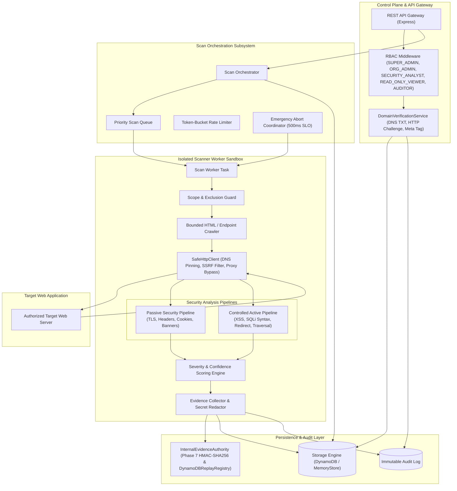
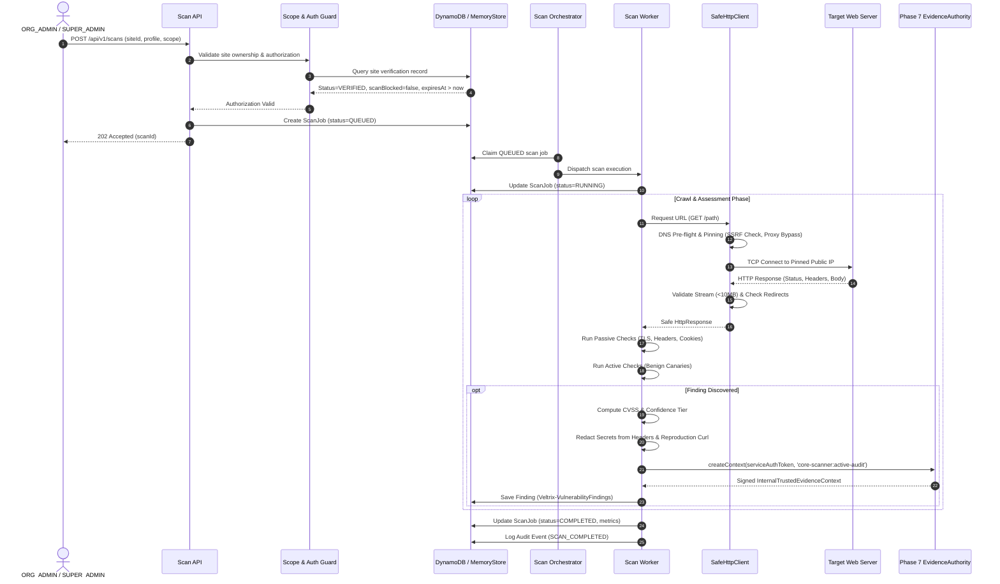

# VELTRIX: Phase 8 Architecture Specification — Authorized Website Vulnerability Assessment

**Document Version:** 1.1.0 (Architecture Review Hardened)  
**Phase:** Phase 8 (Architecture & Planning)  
**Classification:** System Architecture & Technical Design  
**Status:** DRAFT / IN REVIEW (PR #14 Consistency Review)  
**Authors:** VELTRIX Core Security Team  

---

## 1. System Architecture Overview

The VELTRIX Authorized Website Vulnerability Assessment Engine is designed as a modular, defense-in-depth scanning pipeline. It operates under strict authorization constraints, decoupling scan orchestration, network transport, security rule evaluation, evidence provenance, and persistent storage.



---

## 2. Component Breakdown

### 2.1 Scope & Authorization Guard (`ScopeGuard`)
- **Responsibility:** Inviolable gatekeeper verifying target validity before any network operation occurs.
- **Invariants Enforced:**
  1. `site.status === 'VERIFIED'`, `!site.scanBlocked`, and `site.expiresAt > Date.now()`.
  2. If the site is in `GRACE_PERIOD`, `EXPIRED`, `SUSPENDED`, or `REVOKED`, scan dispatch is aborted immediately.
  3. Target URL scheme is strictly `http:` or `https:`.
  4. FQDN matches verified `primaryDomain` or explicitly approved entries in `approvedSubdomains`.
  5. URL path does not match any regex in `excludedPaths`.
  6. Port is explicitly permitted (default: 80, 443, 8080, 8443).

### 2.2 Hardened Safe HTTP Transport Layer (`SafeHttpClient`)
- **Responsibility:** Executes all outbound network connections with comprehensive SSRF, DNS rebinding, proxy isolation, separate request authorization contexts, hop-by-hop redirect safety, and streaming resource safeguards.
- **Core Architecture & Operating Principles:**
  - Built upon custom Node.js `http.Agent` and `https.Agent` socket creation overrides.
  - Acts as the foundational egress transport layer for all scanner operations (crawler, passive inspection, active probing) while providing backward compatibility for domain verification.

#### 2.2.1 Separate Request Authorization Purposes & Context Derivation
To prevent circular authorization dependencies and eliminate unauthorized scanning bypasses, `SafeHttpClient` strictly distinguishes two internally governed request purposes:

1. **`DOMAIN_OWNERSHIP_VERIFICATION` Context**:
   - **Scope & Applicability:** Permitted exclusively for verifying ownership challenges against a registered website asset (`/.well-known/veltrix-challenge/<token>` and root document HTML `<meta>` tags).
   - **Circular Dependency Elimination:** Verification takes place *before* a domain is verified. Therefore, this context **must not** require the target website to already possess `VERIFIED` status.
   - **Anti-Bypass Guard:** This context is strictly pinned to the asset's registered `primaryDomain` and explicit challenge paths. It is structurally barred from arbitrary URI traversal, active probing, or generalized scanning.
   - **Strict Redirect Ban:** `maxRedirects` is hardcoded to `0`. Verification requests **never** follow redirects under any circumstances.

2. **`AUTHORIZED_SCAN` Context**:
   - **Scope & Applicability:** Used for all scanner worker traffic (crawling, passive rules, active canary probes).
   - **Inviolable Precondition:** Requires a verified, server-derived website and tenant context where `site.status === 'VERIFIED'`, `!site.scanBlocked`, and `site.expiresAt > Date.now()`.
   - **Scope Guard Integration:** Requires an active, server-controlled `ScopeGuard` enforcing `allowedHosts` (primary domain + approved subdomains), `excludedPaths`, and permitted ports.
   - **Pre-Flight Enforcement:** Authorization and scope evaluations occur **prior** to initiating DNS queries and prior to socket connection. Every subsequent redirect hop is re-validated against the authorized scope before dispatch.

- **Server-Derived Context Invariant:**
  - Request authorization contexts are constructed strictly by trusted internal service layers (e.g. `DomainOwnershipVerifier` or `ScanWorker`).
  - Untrusted API clients, HTTP headers, or query parameters can **never** select the request purpose or forge authorization tokens.

#### 2.2.2 Hop-by-Hop Redirect Validation Policy
Redirect handling is a primary vector for SSRF escalation and cross-tenant boundary escape:
- **Default Behavior:** `maxRedirects` defaults to `0` across all requests.
- **Domain Verification:** Zero redirects permitted (`maxRedirects = 0`). Any 3xx response immediately fails closed.
- **Authorized Scanning:** May follow redirects if and only if an explicit redirect policy and scope guard are configured:
  1. **Hop Ceiling:** Maximum 5 redirect hops. Exceeding 5 hops terminates the chain with `MAX_REDIRECTS_EXCEEDED`.
  2. **Loop Detection:** Maintains a set of visited canonical URLs (`visitedUrls`). Any cyclical redirect triggers immediate termination with `REDIRECT_LOOP_DETECTED`.
  3. **Hop-by-Hop Revalidation:** Every intermediate hop must undergo:
     - Target URL protocol validation: strictly `http:` or `https:`.
     - Scheme downgrade ban: **strictly rejects HTTPS-to-HTTP downgrades** to prevent plaintext credential exposure.
     - Scope revalidation: destination host must belong to `allowedHosts` under the active `ScopeGuard`. Cross-origin redirects out of scope are blocked.
     - DNS resolution with timeout: destination host is resolved pre-flight.
     - SSRF & IP denylist validation: every resolved IPv4/IPv6 address must pass the denylist and positive `2000::/3` policy before connecting.
  4. **Credential & Header Hygiene:** On cross-origin redirects (e.g., between approved subdomains), sensitive headers (`Authorization`, `Cookie`, and tenant custom headers) are stripped prior to dispatch.
  5. **Status-Specific Semantics:** HTTP 303 redirects force conversion of method to `GET` and discard request body per RFC 7231.

#### 2.2.3 HTTP Method and Outbound Port Policy
- **Method Restrictions:**
  - Ordinary scanner requests (crawling and passive inspection) default to `GET` and `HEAD` methods only.
  - Unrestricted `DELETE`, `PUT`, `PATCH`, or `POST` methods are strictly barred from the general transport interface.
  - Any future active probe requiring non-GET/HEAD operations (e.g., specialized API canary probes in TASK-805) must use an explicitly authorized operation policy scoped specifically to that probe module.
- **Port Restrictions:**
  - Outbound connection ports default strictly to `80` (HTTP) and `443` (HTTPS).
  - Outbound connections to non-standard ports (e.g., `8080`, `8443`) are rejected by default unless explicitly whitelisted in the asset's verified configuration and approved by an internal server policy. High ephemeral ports and common internal service ports (e.g., 22, 3306, 5432, 6379, 27017) are categorically blocked.

#### 2.2.4 Pre-Flight DNS Resolution, IP Pinning & Positive IPv6 Policy
Preserves and unifies the security guarantees established in TASK-801 (PR #15 & PR #16):
- **Ambient Proxy Isolation:** Direct TCP socket creation bypasses ambient `HTTP_PROXY` and `HTTPS_PROXY` environment variables by default to eliminate proxy-based SSRF bypass.
- **Pre-Flight DNS Resolution:** Resolves target hostname for all A and AAAA records using `AddressResolverInterface.lookup(hostname, { all: true })` bounded by a strict DNS timeout.
- **Multi-Record Fail-Closed Mandate:** Validates *every* returned address. If **any** record is invalid, malformed, or prohibited, the entire request fails closed immediately.
- **IPv4 Canonical Normalization & Denylist:** Normalizes octal (`0177.0.0.1`), hex (`0x7f.0.0.1`), dword (`2130706433`), and zero-compressed (`127.1`) inputs. Blocks RFC 1918 private space, loopback (`127.0.0.0/8`), link-local / IMDS (`169.254.0.0/16`), CGNAT (`100.64.0.0/10`), multicast/broadcast, and testnets.
- **Strict RFC 4291/5952 IPv6 Parsing:**
  - Enforces mandatory zero-compression: when `::` is present, requires `missing >= 1`. Addresses containing 8 hextets plus `::` fail closed as invalid syntax.
  - Strict zone identifier rejection: scoped zone IDs (`%interface`) are rejected (`return null`), never silently stripped.
- **Positive IPv6 Global-Unicast Policy (`2000::/3`):**
  - Only Global Unicast space (`(w0 & 0xe000) === 0x2000`) is routable. All non-global, unallocated (`4000::1`), reserved (`fe00::1`, `f000::1`), deprecated IPv4-compatible (`::8.8.8.8`), IPv4-mapped (`::ffff:...`), ULA (`fc00::/7`), and link-local (`fe80::/10`) addresses are prohibited.
  - Within `2000::/3`, preserves exclusions for IETF special-purpose space (`2001::/23`) and documentation blocks (`2001:db8::/32`, `3fff::/20`).
  - Preserves 6to4 policy (`2002::/16`) evaluating embedded IPv4 bytes against SSRF denylist.
- **Socket-Level IP Pinning (TOCTOU Elimination):**
  - Selects first validated IP record (`pinnedIp`).
  - Intercepts connection via `agent.createConnection` and calls `net.createConnection({ host: pinnedIp, port })`.
  - Overrides agent `lookup` callback to return `pinnedIp`, completely eliminating secondary DNS lookups.
  - Passes TLS SNI `servername: parsedUrl.hostname` and enforces `rejectUnauthorized: true` for strict certificate validation.

#### 2.2.5 Streaming Decompression & Multi-Layer Resource Ceilings
To prevent Denial-of-Service, memory exhaustion, and zip-bombs:
- **Streaming Enforcement:** Size limits are enforced continuously during stream consumption; the client **never** trusts `Content-Length` headers alone.
- **Independent Resource Ceilings:**
  1. **Raw Compressed Bytes Ceiling:** Maximum **2 MB** of compressed wire data.
  2. **Decompressed Bytes Ceiling:** Maximum **10 MB** of uncompressed body data.
  3. **Compression Expansion Ratio Ceiling:** Maximum **100:1** ratio. If decompressed throughput exceeds 100x the consumed compressed bytes (after a 64 KB warm-up), a zip-bomb is flagged.
  4. **Decompression Time & Resource Watchdog:** Enforces CPU/time bounds on decompression transform streams.
- **Immediate Socket Destruction:** If any ceiling is breached or a malformed/unsupported encoding is encountered, the decompressor stream, response stream, and underlying socket are destroyed immediately (`socket.destroy()`) and the request promise rejects with `MAX_RESPONSE_SIZE_EXCEEDED` or `DECOMPRESSION_BOMB_DETECTED`.

#### 2.2.6 Multi-Stage Timeouts & Scan-Scoped Active Socket Registry
- **Granular Timeout Stages:**
  - **Connection Timeout:** 5,000 ms (TCP connect and TLS handshake).
  - **Response Header Timeout:** 10,000 ms (time from connection to first response header byte).
  - **Body Idle Timeout:** 15,000 ms (maximum silence between response body chunks).
  - **Total Request Timeout:** 30,000 ms (absolute end-to-end watchdog).
- **Scan-Scoped Active Socket Registry (`ActiveSocketRegistry`):**
  - Sockets are registered with their associated `scanId` and `orgId`.
  - **Tenant-Isolated Emergency Cancellation:** The orchestrator invokes `abortScan(scanId)`, which closes all active sockets belonging to that specific scan within **500 ms** SLO without disrupting concurrent scans from the same or other tenants.
  - **Lifecycle Cleanup:** Socket registrations are deterministically deregistered upon request completion, failure, timeout, or abort.
  - **Process-Wide Abort Reserve:** Process-level socket termination (`abortAllSockets()`) is strictly reserved for host process shutdown or catastrophic host emergency.

#### 2.2.7 Connection Reuse & Pooling Policy
- **Default Policy:** Cross-request connection reuse is **disabled** by default (`keepAlive: false`, `Connection: close`) to ensure maximum isolation and deterministic IP pinning per request.
- **Future Pooling Constraints:** If persistent pooling is introduced in future phases for high-throughput scanning:
  - Connection pools must be strictly partition-keyed by `(orgId, scanId, destinationHost, pinnedIp, port, tlsIdentity)`.
  - Sockets must **never** be shared across tenants or across distinct scan scopes.

#### 2.2.8 Backward-Compatible Shared Transport Extraction Plan
- The core IP parsing and SSRF classification functions from TASK-801 (`parseIpv4ToNumber`, `normalizeIpv4`, `isProhibitedIpv4Bytes`, `isProhibitedIpv4`, `parseIpv6`, `isIpLiteral`, `isProhibitedIp`) will be extracted into `backend/src/scanner/transport/ip-validator.ts`.
- `backend/src/scanner/verification/http-verifier.ts` will import and re-export these functions, preserving 100% backward compatibility for all existing TASK-801 imports and tests without duplicating security logic.
- `DefaultHttpFetcher` will function as an adapter utilizing the underlying hardened transport mechanisms.

---

### 2.3 Bounded Crawler & Endpoint Discovery Engine (`BoundedCrawler`)
- **Responsibility:** Discovers accessible web surface area without triggering destructive actions or crossing domain boundaries.
- **Design Parameters:**
  - **Traversal Algorithm:** Breadth-First Search (BFS) with configurable depth limit (default 3, max 5) and page limit (default 250, max 1000).
  - **Link Extraction:** Parses HTML `href` attributes, `<form action>` endpoints, `<script src>`, and `<link href>`.
  - **URL Normalization & Deduplication:** Removes URL fragments (`#...`), canonicalizes parameters (sorted lexicographically), strips session IDs (e.g., `jsessionid`, `phpsessid`), and tracks visited canonical URLs in a bounded set.
  - **Safety Boundaries:**
    - Issues `GET` and `HEAD` requests only.
    - Strictly forbids crawling outside `allowedHosts`.
    - Skips binary files (e.g., `.png`, `.jpg`, `.pdf`, `.zip`, `.exe`, `.mp4`).
    - Respects `robots.txt` exclusion directives when enabled in scan configuration.

### 2.4 Passive Security Analyzer (`PassiveAnalyzer`)
- **Responsibility:** Inspects server responses without sending any probing or intrusive payloads.
- **Inspection Rules:**
  1. **TLS / SSL Configuration (`RULE_PASSIVE_TLS`):**
     - TLS protocol version check (flags TLS 1.0, 1.1; verifies TLS 1.2, 1.3).
     - Certificate expiration check (flags expired or expiring within 14 days).
     - Hostname matching and certificate chain trust verification.
  2. **HTTP Security Headers (`RULE_PASSIVE_HEADERS`):**
     - `Strict-Transport-Security` (HSTS): Verifies presence, `max-age >= 31536000`, `includeSubDomains`.
     - `Content-Security-Policy` (CSP): Flags missing header, `unsafe-inline`, `unsafe-eval`, or wildcard `*` origins.
     - `X-Frame-Options`: Verifies `DENY` or `SAMEORIGIN` (mitigates clickjacking).
     - `X-Content-Type-Options`: Verifies `nosniff`.
     - `Referrer-Policy`: Verifies restrictive policy (e.g., `strict-origin-when-cross-origin`).
     - `Permissions-Policy`: Verifies camera, microphone, geolocation restrictions.
  3. **Cookie Security Attributes (`RULE_PASSIVE_COOKIES`):**
     - Inspects all `Set-Cookie` headers for `Secure`, `HttpOnly`, and `SameSite` (`Lax`/`Strict`).
  4. **Information Disclosure & Banner Leakage (`RULE_PASSIVE_DISCLOSURE`):**
     - Flags revealing server banners (`Server: Apache/2.4.1`, `X-Powered-By: PHP/7.4`).
     - Flags exposed debug endpoints, stack traces, `.git/HEAD`, `.env`.

### 2.5 Controlled Active Security Analyzer (`ActiveAnalyzer`)
- **Responsibility:** Executes controlled, benign active probes against discovered endpoints.
- **Strict Non-Destructive Invariant:** No modification of database records, no deletion of files, no state alteration.
- **Probe Plugins:**
  1. **Reflected XSS Canary Check (`RULE_ACTIVE_XSS_CANARY`):**
     - Generates an inert, non-executable alphanumeric canary: `vltxcanary_<random16Hex>`.
     - Appends canary to query parameters.
     - Inspects response body to see if the canary is reflected verbatim without proper HTML/attribute entity escaping.
     - Status code check is insufficient; reflection context (HTML body, script block, attribute) is analyzed.
  2. **SQL Syntax Anomaly Check (`RULE_ACTIVE_SQLI_ANOMALY`):**
     - Appends benign syntax disruptor tokens (`'`, `"`, `''`) to numeric or string parameters.
     - Compares baseline response vs probe response.
     - Searches response body for known RDBMS syntax error signatures (MySQL, PostgreSQL, Oracle, SQLite, MSSQL).
     - Does NOT attempt data exfiltration, blind sleep loops, or boolean injection.
  3. **Open Redirect Canary Check (`RULE_ACTIVE_OPEN_REDIRECT`):**
     - Supplies canary parameter `redirect=https://example.com/vltx_canary`.
     - Checks if response is `301`/`302`/`307`/`308` and `Location` header points to `example.com/vltx_canary`.
  4. **Path Traversal Canary Check (`RULE_ACTIVE_PATH_TRAVERSAL`):**
     - Supplies non-sensitive traversal probe (e.g., `../../../../etc/nonexistent_canary_probe`).
     - Detects characteristic error messages indicating path processing flaws without leaking sensitive system files.

### 2.6 Severity & Confidence Scoring Engine (`ScoringEngine`)
- **Responsibility:** Computes standardized risk metrics for all discovered findings.
- **Scoring Dimensions:**
  - **Base Severity:** `CRITICAL` (CVSS 9.0–10.0), `HIGH` (CVSS 7.0–8.9), `MEDIUM` (CVSS 4.0–6.9), `LOW` (CVSS 0.1–3.9), `INFORMATIONAL` (CVSS 0.0).
  - **Confidence Tier:**
    - `CONFIRMED`: Verifiable canary reflection or cryptographic mismatch.
    - `HIGH`: Deterministic error signature matched with differential response verification.
    - `MEDIUM`: Header anomaly or heuristic indicator without execution proof.
    - `LOW`: Heuristic match with possible false positive indicators.
- **False-Positive Suppression:**
  - Requires differential baseline comparison (e.g., parameter reflection must not have been present in the baseline request).
  - Status code changes alone (e.g., 500 Internal Server Error) are marked `LOW` confidence unless corroborated by an explicit syntax error signature.

### 2.7 Evidence Aggregator & Provenance Signer (`EvidenceSigner`)
- **Responsibility:** Constructs tamper-evident proof for every finding, integrating with Phase 7 `InternalEvidenceAuthority`.
- **Evidence Lifecycle:**
  1. Sanitizes request/response pair (strips passwords, Authorization headers, session cookies, API keys).
  2. Generates sanitized reproduction curl command with credentials redacted.
  3. Truncates response body to maximum 64 KB.
  4. Computes SHA-256 hash of raw target payload and raw response body.
  5. Obtains an authenticated `InternalTrustedEvidenceContext` by calling `InternalEvidenceAuthority.prototype.createContext()`:
     ```typescript
     const trustedContext = authority.createContext({
       serviceAuthToken: process.env.VELTRIX_AUTH_CORE_SCANNER!,
       verifierIdentity: 'core-scanner:active-audit',
       provenance: 'TRUSTED_SERVER_COMPONENT',
       eventId: findingId,
       orgId: site.orgId,
       siteId: site.siteId,
       verifiedSignalIdentifiers: [signalIdentifier],
       evidenceReferences: [reproductionCurlHash],
       verifiedResponseEvidence: {
         responseBody: sanitizedSnippet,
         errorMessage: detectedSyntaxError,
       },
     });
     ```
  6. Stores cryptographic signature and provenance context alongside finding record in DynamoDB table `Veltrix-VulnerabilityFindings`.

### 2.8 Scan Orchestration & Emergency Abort Engine (`ScanOrchestrator`)
- **Responsibility:** Coordinates scan execution, enforces concurrency ceilings, and handles emergency stops.
- **Concurrency & Rate Controls:**
  - Per-target rate limiting: Token-bucket algorithm with configurable RPS (default 5, max 20).
  - Concurrency limits: 1 scan per website, 3 scans per organization.
- **Emergency Abort Protocol (500 ms SLO):**
  1. API receives `POST /api/v1/scans/:scanId/abort` OR site verification is revoked via `POST /api/v1/websites/:siteId/revoke`.
  2. Updates scan job record in DynamoDB with `status = 'ABORT_REQUESTED'`.
  3. Abort coordinator signals the active worker's `AbortController`.
  4. Active HTTP client immediately destroys all pending and active sockets (`socket.destroy()`).
  5. Worker drains pending queues and persists findings gathered up to the abort timestamp.
  6. Scan status transitions to `ABORTED`.
  7. If worker does not acknowledge within 10 seconds, coordinator force-terminates the worker task and sets status to `ABORT_FAILED_TIMED_OUT`.

---

## 3. End-to-End Scan Execution Flow



---

## 4. Integration with Existing VELTRIX Components

| Component | Integration Touchpoint | Technical Mechanism |
| :--- | :--- | :--- |
| **`StorageInterface`** | Data persistence for assets, scans, findings | Implemented across both `DynamoDBStore` (AWS) and `MemoryStore` (isolated tests). |
| **`InternalEvidenceAuthority`** | Evidence authenticity & non-repudiation | Issues HMAC-SHA256 signatures for findings using approved verifier `'core-scanner:active-audit'` and credential `VELTRIX_AUTH_CORE_SCANNER`. |
| **`AuditLog`** | Tamper-evident compliance tracking | Emits structured audit events for `WEBSITE_REGISTERED`, `WEBSITE_VERIFIED`, `WEBSITE_REVOKED`, `SCAN_STARTED`, `SCAN_ABORTED`, and `SCAN_COMPLETED`. |
| **`EventService` / Detections** | Real-time correlation with live attacks | Vulnerability findings correlated with real-time detection telemetry via `siteId` and endpoint path. |
| **`jwtService` / `requireRole`** | Authentication & RBAC | Enforces canonical production roles: `SUPER_ADMIN`, `ORG_ADMIN`, `SECURITY_ANALYST`, `READ_ONLY_VIEWER`, and `AUDITOR`. |
