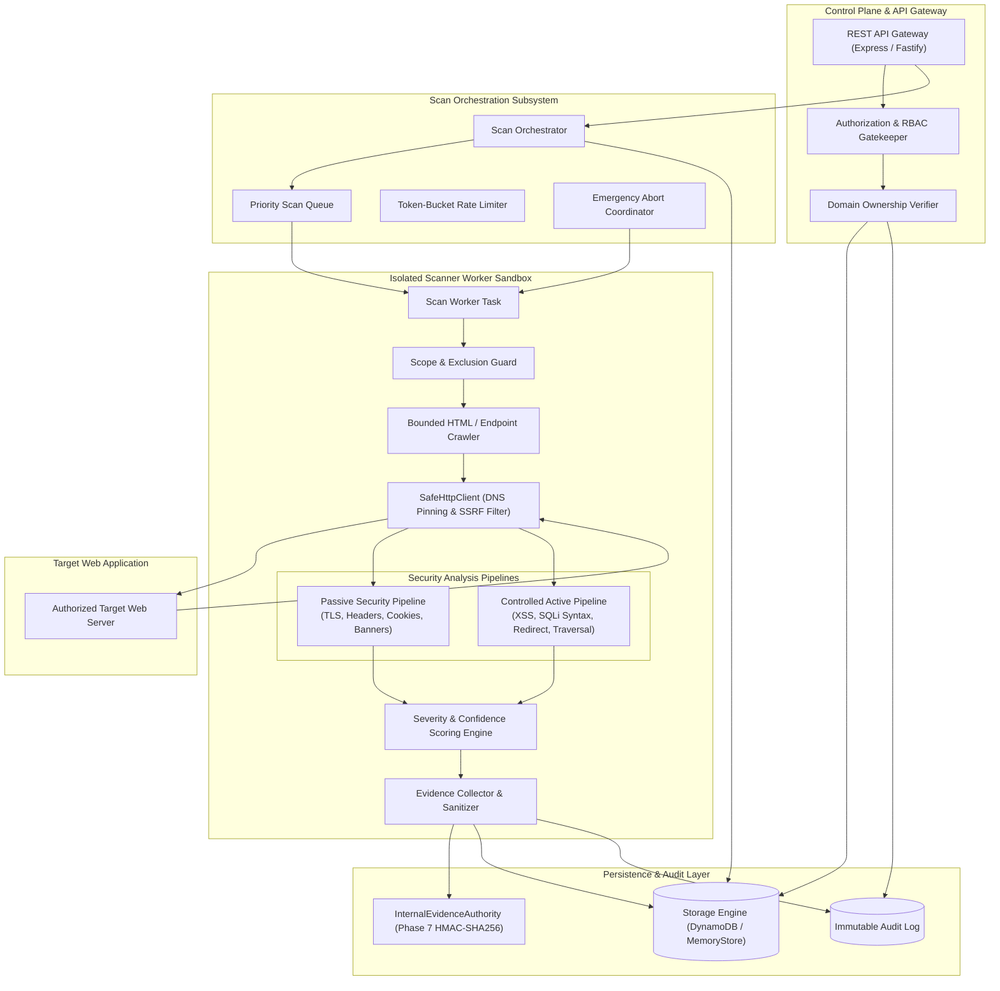
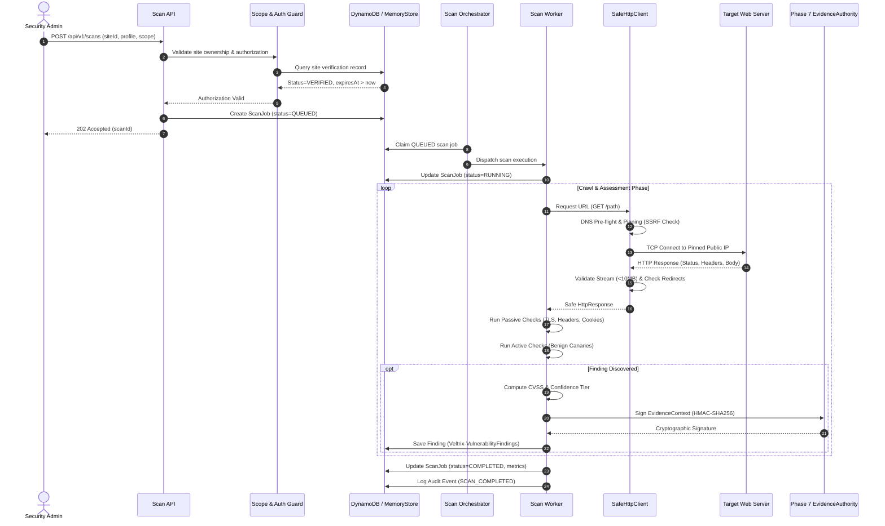

# VELTRIX: Phase 8 Architecture Specification — Authorized Website Vulnerability Assessment

**Document Version:** 1.0.0  
**Phase:** Phase 8 (Architecture & Planning)  
**Classification:** System Architecture & Technical Design  
**Status:** DRAFT / IN REVIEW  
**Authors:** VELTRIX Core Security Team  

---

## 1. System Architecture Overview

The VELTRIX Authorized Website Vulnerability Assessment Engine is designed as a modular, defense-in-depth scanning pipeline. It operates under strict authorization constraints, decoupling scan orchestration, network transport, security rule evaluation, evidence provenance, and persistent storage.



---

## 2. Component Breakdown

### 2.1 Scope & Authorization Guard (`ScopeGuard`)
- **Responsibility:** Inviolable gatekeeper verifying target validity before any network operation occurs.
- **Invariants Enforced:**
  1. `site.status === 'VERIFIED'` and `site.expiresAt > Date.now()`.
  2. Target URL scheme is strictly `http:` or `https:`.
  3. FQDN matches verified `primaryDomain` or explicitly approved entries in `approvedSubdomains`.
  4. URL path does not match any regex in `excludedPaths`.
  5. Port is explicitly permitted (default: 80, 443, 8080, 8443).

### 2.2 Hardened Safe HTTP Transport Layer (`SafeHttpClient`)
- **Responsibility:** Executes all outbound network connections with comprehensive SSRF, DNS rebinding, and payload size protections.
- **Core Architecture:**
  - Built upon custom Node.js `http.Agent` and `https.Agent` overrides.
  - **Pre-Flight DNS Resolution & IP Validation:**
    - Custom resolver queries configured system DNS.
    - Evaluates all returned IPv4 and IPv6 addresses against strict denylists.
    - Denylist covers:
      - `127.0.0.0/8` (Loopback)
      - `10.0.0.0/8`, `172.16.0.0/12`, `192.168.0.0/16` (RFC 1918 Private)
      - `169.254.0.0/16` (Link-Local & Cloud Metadata `169.254.169.254`)
      - `100.64.0.0/10` (Carrier-Grade NAT)
      - `0.0.0.0/8` (Broadcast / Current Network)
      - `::1/128` (IPv6 Loopback)
      - `fe80::/10` (IPv6 Link-Local)
      - `fc00::/7` (IPv6 Unique Local)
      - `::ffff:0:0/96` (IPv4-Mapped IPv6)
      - `64:ff9b::/96` (IPv4/IPv6 Translation)
  - **DNS Pinning at Socket Level (TOCTOU Elimination):**
    - The `createConnection` hook intercepts the socket connection.
    - Instead of letting the operating system re-resolve the hostname upon `connect()`, the pre-validated IP address is directly passed to `net.createConnection({ host: pinnedIp, port })`.
    - For TLS connections, the original hostname is preserved strictly for SNI (Server Name Indication) and certificate hostname verification (`checkServerIdentity`).
  - **Hop-by-Hop Redirect Validation:**
    - Standard automated redirect following (`maxRedirects > 0`) is intercepted at every step.
    - For any `301`, `302`, `303`, `307`, or `308` response, the `Location` header is parsed and resolved against the current URL.
    - The redirect target is passed through the complete `ScopeGuard` and `SafeHttpClient` pre-flight validation before a subsequent connection is permitted.
    - Maximum redirect depth is capped at 5.
  - **Stream Safeguards & Timeout Boundaries:**
    - Maximum response stream size: 10 MB (prevents memory exhaustion or decompression bombs).
    - Connection timeout: 5,000 ms.
    - Response header timeout: 10,000 ms.
    - Response body idle timeout: 15,000 ms.

### 2.3 Bounded Crawler & Endpoint Discovery Engine (`BoundedCrawler`)
- **Responsibility:** Discovers accessible web surface area without triggering destructive actions or crossing domain boundaries.
- **Design Parameters:**
  - **Traversal Algorithm:** Breadth-First Search (BFS) with configurable depth limit (default 3, max 5) and page limit (default 250, max 1000).
  - **Link Extraction:** Parses HTML `href` attributes, `<form action>` endpoints, `<script src>`, and `<link href>`.
  - **URL Normalization & Deduplication:** Removes URL fragments (`#...`), canonicalizes parameters (sorted lexicographically), strips session IDs (e.g., `jsessionid`, `phpsessid`), and tracks visited canonical URLs in a bounded set.
  - **Safety Boundaries:**
    - Issues `GET` and `HEAD` requests only.
    - Strictly forbids crawling outside `allowedHosts`.
    - Skips binary files (e.g., `.png`, `.jpg`, `.pdf`, `.zip`, `.exe`, `.mp4`).
    - Respects `robots.txt` exclusion directives when enabled in scan configuration.

### 2.4 Passive Security Analyzer (`PassiveAnalyzer`)
- **Responsibility:** Inspects server responses without sending any probing or intrusive payloads.
- **Inspection Rules:**
  1. **TLS / SSL Configuration (`RULE_PASSIVE_TLS`):**
     - TLS protocol version check (flags TLS 1.0, 1.1; verifies TLS 1.2, 1.3).
     - Certificate expiration check (flags expired or expiring within 14 days).
     - Hostname matching and certificate chain trust verification.
  2. **HTTP Security Headers (`RULE_PASSIVE_HEADERS`):**
     - `Strict-Transport-Security` (HSTS): Verifies presence, `max-age >= 31536000`, `includeSubDomains`.
     - `Content-Security-Policy` (CSP): Flags missing header, `unsafe-inline`, `unsafe-eval`, or wildcard `*` origins.
     - `X-Frame-Options`: Verifies `DENY` or `SAMEORIGIN` (mitigates clickjacking).
     - `X-Content-Type-Options`: Verifies `nosniff`.
     - `Referrer-Policy`: Verifies restrictive policy (e.g., `strict-origin-when-cross-origin`).
     - `Permissions-Policy`: Verifies camera, microphone, geolocation restrictions.
  3. **Cookie Security Attributes (`RULE_PASSIVE_COOKIES`):**
     - Inspects all `Set-Cookie` headers for `Secure`, `HttpOnly`, and `SameSite` (`Lax`/`Strict`).
  4. **Information Disclosure & Banner Leakage (`RULE_PASSIVE_DISCLOSURE`):**
     - Flags revealing server banners (`Server: Apache/2.4.1`, `X-Powered-By: PHP/7.4`).
     - Flags exposed debug endpoints, stack traces, `.git/HEAD`, `.env`.

### 2.5 Controlled Active Security Analyzer (`ActiveAnalyzer`)
- **Responsibility:** Executes controlled, benign active probes against discovered endpoints.
- **Strict Non-Destructive Invariant:** No modification of database records, no deletion of files, no state alteration.
- **Probe Plugins:**
  1. **Reflected XSS Canary Check (`RULE_ACTIVE_XSS_CANARY`):**
     - Generates an inert, non-executable alphanumeric canary: `vltxcanary_<random16Hex>`.
     - Appends canary to query parameters.
     - Inspects response body to see if the canary is reflected verbatim without proper HTML/attribute entity escaping.
     - Status code check is insufficient; reflection context (HTML body, script block, attribute) is analyzed.
  2. **SQL Syntax Anomaly Check (`RULE_ACTIVE_SQLI_ANOMALY`):**
     - Appends benign syntax disruptor tokens (`'`, `"`, `''`) to numeric or string parameters.
     - Compares baseline response vs probe response.
     - Searches response body for known RDBMS syntax error signatures (MySQL, PostgreSQL, Oracle, SQLite, MSSQL).
     - Does NOT attempt data exfiltration, blind sleep loops, or boolean injection.
  3. **Open Redirect Canary Check (`RULE_ACTIVE_OPEN_REDIRECT`):**
     - Supplies canary parameter `redirect=https://example.com/vltx_canary`.
     - Checks if response is `301`/`302`/`307`/`308` and `Location` header points to `example.com/vltx_canary`.
  4. **Path Traversal Canary Check (`RULE_ACTIVE_PATH_TRAVERSAL`):**
     - Supplies non-sensitive traversal probe (e.g., `../../../../etc/nonexistent_canary_probe`).
     - Detects characteristic error messages indicating path processing flaws without leaking sensitive system files.

### 2.6 Severity & Confidence Scoring Engine (`ScoringEngine`)
- **Responsibility:** Computes standardized risk metrics for all discovered findings.
- **Scoring Dimensions:**
  - **Base Severity:** `CRITICAL` (CVSS 9.0–10.0), `HIGH` (CVSS 7.0–8.9), `MEDIUM` (CVSS 4.0–6.9), `LOW` (CVSS 0.1–3.9), `INFORMATIONAL` (CVSS 0.0).
  - **Confidence Tier:**
    - `CONFIRMED`: Verifiable canary reflection or cryptographic mismatch.
    - `HIGH`: Deterministic error signature matched with differential response verification.
    - `MEDIUM`: Header anomaly or heuristic indicator without execution proof.
    - `LOW`: Heuristic match with possible false positive indicators.
- **False-Positive Suppression:**
  - Requires differential baseline comparison (e.g., parameter reflection must not have been present in the baseline request).
  - Status code changes alone (e.g., 500 Internal Server Error) are marked `LOW` confidence unless corroborated by an explicit syntax error signature.

### 2.7 Evidence Aggregator & Provenance Signer (`EvidenceSigner`)
- **Responsibility:** Constructs tamper-evident proof for every finding, integrating with Phase 7 `InternalEvidenceAuthority`.
- **Evidence Lifecycle:**
  1. Sanitizes request/response pair (strips passwords, Authorization headers, session cookies).
  2. Truncates response body to maximum 64 KB.
  3. Computes SHA-256 hash of raw target payload and raw response body.
  4. Emits `EvidenceContext`:
     ```typescript
     interface VulnerabilityEvidenceContext {
       targetUrl: string;
       method: string;
       requestHeaders: Record<string, string>;
       requestBodyPreview?: string;
       responseStatus: number;
       responseHeaders: Record<string, string>;
       responseBodySnippet: string;
       canaryPayload?: string;
       reproductionCurl: string;
       timestamp: string;
       nonce: string;
     }
     ```
  5. Signs the evidence bundle using `InternalEvidenceAuthority.prototype.signEvidencePayload()`.
  6. Stores cryptographic signature alongside finding record in DynamoDB.

### 2.8 Scan Orchestration & Emergency Abort Engine (`ScanOrchestrator`)
- **Responsibility:** Coordinates scan execution, enforces concurrency ceilings, and handles emergency stops.
- **Concurrency & Rate Controls:**
  - Per-target rate limiting: Token-bucket algorithm with configurable RPS (default 5, max 20).
  - Concurrency limits: 1 scan per website, 3 scans per organization.
- **Emergency Abort Protocol (500 ms SLO):**
  1. API receives `POST /api/v1/scans/:scanId/abort`.
  2. Updates scan job record in DynamoDB with `status = 'ABORT_REQUESTED'`.
  3. Abort coordinator signals the active worker's `AbortController`.
  4. Active HTTP client immediately destroys all pending and active sockets (`socket.destroy()`).
  5. Worker drains pending queues and persists findings gathered up to the abort timestamp.
  6. Scan status transitions to `ABORTED`.
  7. If worker does not acknowledge within 10 seconds, coordinator force-terminates the worker task and sets status to `ABORT_FAILED_TIMED_OUT`.

---

## 3. End-to-End Scan Execution Flow



---

## 4. Integration with Existing VELTRIX Components

| Component | Integration Touchpoint | Technical Mechanism |
| :--- | :--- | :--- |
| **`StorageInterface`** | Data persistence for assets, scans, findings | Implemented across both `DynamoDBStore` (AWS) and `MemoryStore` (isolated tests). |
| **`InternalEvidenceAuthority`** | Evidence authenticity & non-repudiation | Generates HMAC-SHA256 signatures for every finding's `EvidenceContext`. |
| **`AuditLog`** | Tamper-evident compliance tracking | Emits structured audit events for registration, verification, scan start, abort, and completion. |
| **`EventService` / Detections** | Real-time correlation with live attacks | Vulnerability findings correlated with real-time detection telemetry via `siteId` and endpoint path. |
| **`jwtService`** | Authentication & RBAC | Enforces JWT token validation and role checks (`SECURITY_ADMIN`, `SECURITY_ANALYST`, `SECURITY_VIEWER`). |
