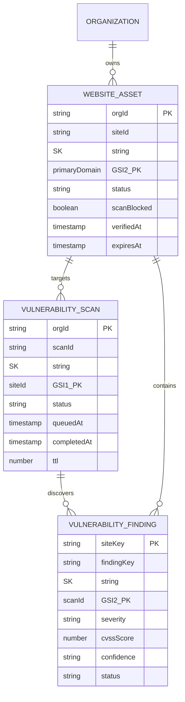

# VELTRIX: Phase 8 Database Schema Specification — Authorized Website Vulnerability Assessment

**Document Version:** 1.1.0 (Architecture Review Hardened)  
**Phase:** Phase 8 (Architecture & Planning)  
**Classification:** Database Architecture & Access Patterns  
**Engine:** Amazon DynamoDB (On-Demand / `PAY_PER_REQUEST`) & `MemoryStore` (Test Harness)  
**Encryption:** AWS KMS (`aws/dynamodb`) AES-256  
**Status:** DRAFT / IN REVIEW (PR #14 Consistency Review)  
**Authors:** VELTRIX Core Security Team  

---

## 1. Data Model & Entity Relationship Overview

The Phase 8 Vulnerability Assessment data architecture is organized into three dedicated DynamoDB tables, aligned with VELTRIX multi-tenant partitioning conventions:



---

## 2. Table Schemas & Index Definitions

### 2.1 Table: `Veltrix-WebsiteAssets`
Stores registered website perimeters, domain ownership verification states, and authorization validity windows. Aligned with production `backend/src/storage/dynamodb-store.ts`.

| Attribute Name | Type | Key Type | Description / Format |
| :--- | :--- | :--- | :--- |
| `PK` | String | **Partition Key** | `ORG#{orgId}` |
| `SK` | String | **Sort Key** | `SITE#{siteId}` |
| `siteId` | String | Attribute | Canonical UUID identifier: `site-018d5f30-...` |
| `orgId` | String | Attribute | Tenant identifier: `org-enterprise-01` |
| `name` | String | Attribute | Friendly site name |
| `primaryDomain` | String | Attribute | FQDN: `portal.example.com` (lowercase, normalized) |
| `approvedSubdomains` | List<String> | Attribute | Array of allowed subdomains |
| `environment` | String | Attribute | `PRODUCTION` \| `STAGING` \| `DEVELOPMENT` |
| `riskTier` | String | Attribute | `LOW` \| `MEDIUM` \| `HIGH` \| `CRITICAL` |
| `status` | String | Attribute | `PENDING_VERIFICATION` \| `VERIFIED` \| `GRACE_PERIOD` \| `REVOKED` \| `SUSPENDED` |
| `scanBlocked` | Boolean | Attribute | Safety invariant: `true` if unverified, grace, expired, or revoked |
| `verificationToken` | String | Attribute | Unique cryptographic challenge token: `vltx_tok_<32Hex>` |
| `tokenHash` | String | Attribute | SHA-256 hash of verification token |
| `tokenCreatedAt` | String (ISO) | Attribute | Challenge creation timestamp (valid for 30 days) |
| `dnsTxtRecord` | Map | Attribute | `{ host: "_veltrix-challenge...", value: "veltrix-verify=..." }` |
| `httpChallenge` | Map | Attribute | `{ url: "https://.../.well-known/...", expectedBody: { ... } }` |
| `verifiedAt` | String (ISO) | Attribute | Timestamp of successful verification confirmation |
| `expiresAt` | String (ISO) | Attribute | Expiration timestamp (verifiedAt + 90 days) |
| `gracePeriodEndsAt`| String (ISO) | Attribute | Grace period end timestamp (now + 7 days) |
| `lastScanAt` | String (ISO) | Attribute | Timestamp of most recent scan launch |
| `tags` | List<String> | Attribute | Organizational classification tags |
| `createdAt` | String (ISO) | Attribute | Record creation timestamp |
| `updatedAt` | String (ISO) | Attribute | Last modification timestamp |

#### Global Secondary Indexes:
- **`GSI1-StatusDomain`:**
  - `GSI1_PK`: `ORG#{orgId}#STATUS#{status}`
  - `GSI1_SK`: `primaryDomain`
  - **Purpose:** Fast tenant filtering of active vs. expired/suspended sites.
- **`GSI2-DomainLookup`:**
  - `GSI2_PK`: `DOMAIN#{primaryDomain}`
  - `GSI2_SK`: `ORG#{orgId}`
  - **Purpose:** Fast lookup of site by domain across the tenant and platform.

#### Atomic Domain Ownership Lock Item:
To guarantee cross-tenant domain uniqueness and eliminate race conditions, `saveWebsite()` writes a companion item in `Veltrix-WebsiteAssets`:
- `PK`: `DOMAIN#{primaryDomain}`
- `SK`: `'OWNERSHIP'`
- `ConditionExpression`: `'attribute_not_exists(PK) OR orgId = :orgId'`
- If another organization attempts to claim the domain, the transaction fails with `ConditionalCheckFailedException`.

---

### 2.2 Table: `Veltrix-VulnerabilityScans`
Tracks the lifecycle, execution progress, metrics, and parameters of vulnerability scan jobs.

| Attribute Name | Type | Key Type | Description / Format |
| :--- | :--- | :--- | :--- |
| `PK` | String | **Partition Key** | `ORG#{orgId}` |
| `SK` | String | **Sort Key** | `SCAN#{queuedAtIso}#{scanId}` |
| `scanId` | String | Attribute | Canonical UUID: `scan-018d5f31-...` |
| `orgId` | String | Attribute | Tenant identifier: `org-enterprise-01` |
| `siteId` | String | Attribute | Targeted site asset ID |
| `scanProfile` | String | Attribute | `PASSIVE_BASELINE` \| `STANDARD_ACTIVE` \| `DEEP_ASSESSMENT` |
| `status` | String | Attribute | `QUEUED` \| `RUNNING` \| `COMPLETED` \| `FAILED` \| `ABORT_REQUESTED` \| `ABORTED` \| `ABORT_FAILED_TIMED_OUT` |
| `scope` | Map | Attribute | Target URL, allowed hosts, max depth, max pages, excluded paths |
| `rateLimitRps` | Number | Attribute | Requests-per-second ceiling (1–20) |
| `queuedAt` | String (ISO) | Attribute | Timestamp scan was placed in queue |
| `startedAt` | String (ISO) | Attribute | Timestamp worker claimed job |
| `completedAt` | String (ISO) | Attribute | Timestamp job finished or aborted |
| `abortedBy` | String | Attribute | User ID of operator requesting abort |
| `abortReason` | String | Attribute | Text justification for emergency stop |
| `metrics` | Map | Attribute | `pagesCrawled`, `requestsSent`, `findingsCount`, `durationMs` |
| `ttl` | Number | Attribute | Epoch seconds for automated record cleanup (retention: 90 days) |

#### Global Secondary Indexes:
- **`GSI1-SiteScans`:**
  - `GSI1_PK`: `SITE#{siteId}`
  - `GSI1_SK`: `queuedAt` (ISO 8601)
  - **Purpose:** Chronological query of scans executed against a specific website asset.
- **`GSI2-OrgScanStatus`:**
  - `GSI2_PK`: `ORG#{orgId}#STATUS#{status}`
  - `GSI2_SK`: `queuedAt` (ISO 8601)
  - **Purpose:** Query all active or queued scans to enforce concurrency ceilings (max 3 per org).

---

### 2.3 Table: `Veltrix-VulnerabilityFindings`
Stores individual discovered vulnerabilities, reproduction metadata, CVSS metrics, and cryptographic signatures.

| Attribute Name | Type | Key Type | Description / Format |
| :--- | :--- | :--- | :--- |
| `PK` | String | **Partition Key** | `ORG#{orgId}#SITE#{siteId}` |
| `SK` | String | **Sort Key** | `FINDING#{severity}#{findingFingerprint}` |
| `findingId` | String | Attribute | Canonical UUID: `find-018d5f32-...` |
| `findingFingerprint` | String | Attribute | Deterministic SHA-256 hash: `hash(siteId, vulnType, endpoint, param)` |
| `scanId` | String | Attribute | Originating scan job ID |
| `siteId` | String | Attribute | Target site ID |
| `orgId` | String | Attribute | Tenant identifier |
| `vulnerabilityType`| String | Attribute | Categorical type (e.g., `XSS_REFLECTED`, `MISSING_HSTS`) |
| `title` | String | Attribute | Human-readable finding summary |
| `description` | String | Attribute | Technical vulnerability narrative |
| `severity` | String | Attribute | `CRITICAL` \| `HIGH` \| `MEDIUM` \| `LOW` \| `INFORMATIONAL` |
| `cvssScore` | Number | Attribute | CVSS v3.1 Base Score (0.0 – 10.0) |
| `cvssVector` | String | Attribute | CVSS v3.1 vector string |
| `confidence` | String | Attribute | `CONFIRMED` \| `HIGH` \| `MEDIUM` \| `LOW` |
| `endpoint` | String | Attribute | Vulnerable URL path |
| `parameter` | String | Attribute | Vulnerable query/form parameter name |
| `method` | String | Attribute | HTTP method (`GET`, `POST`, etc.) |
| `status` | String | Attribute | `OPEN` \| `RESOLVED` \| `FALSE_POSITIVE` \| `ACCEPTED_RISK` |
| `evidence` | Map | Attribute | Sanitized request/response, snippet, curl snippet, timestamp |
| `provenance` | Map | Attribute | `InternalTrustedEvidenceContext` signed by Phase 7 EvidenceAuthority |
| `firstSeenAt` | String (ISO) | Attribute | Earliest discovery timestamp |
| `lastSeenAt` | String (ISO) | Attribute | Most recent confirmation timestamp |
| `updatedAt` | String (ISO) | Attribute | Triage update timestamp |
| `updatedBy` | String | Attribute | User ID of analyst triaging finding |

#### Global Secondary Indexes:
- **`GSI1-FindingTriage`:**
  - `GSI1_PK`: `ORG#{orgId}#STATUS#{status}`
  - `GSI1_SK`: `cvssScore` (Numeric descending)
  - **Purpose:** Prioritized triage queue for open findings ordered by risk severity.
- **`GSI2-ScanFindings`:**
  - `GSI2_PK`: `SCAN#{scanId}`
  - `GSI2_SK`: `findingId`
  - **Purpose:** Immediate retrieval of all findings discovered in a specific scan run.

---

## 3. Strict Conditional Write Semantics

### 3.1 Domain Registration Uniqueness
Uses DynamoDB `TransactWriteItems` to atomically create the site record and lock the domain:
```typescript
const transactItems = [
  {
    Put: {
      TableName: 'Veltrix-WebsiteAssets-dev',
      Item: {
        PK: `ORG#${site.orgId}`,
        SK: `SITE#${site.siteId}`,
        GSI1_PK: `ORG#${site.orgId}#STATUS#${site.status}`,
        GSI1_SK: normalizedDomain,
        GSI2_PK: `DOMAIN#${normalizedDomain}`,
        GSI2_SK: `ORG#${site.orgId}`,
        ...site,
      },
    },
  },
  {
    Put: {
      TableName: 'Veltrix-WebsiteAssets-dev',
      Item: {
        PK: `DOMAIN#${normalizedDomain}`,
        SK: 'OWNERSHIP',
        orgId: site.orgId,
        siteId: site.siteId,
      },
      ConditionExpression: 'attribute_not_exists(PK) OR orgId = :orgId',
      ExpressionAttributeValues: { ':orgId': site.orgId },
    },
  },
];
```

### 3.2 Atomic Scan Dispatch & Worker Claiming
```typescript
const updateParams = {
  TableName: 'Veltrix-VulnerabilityScans-dev',
  Key: { PK: `ORG#${orgId}`, SK: `SCAN#${queuedAt}#${scanId}` },
  UpdateExpression: 'SET #s = :running, startedAt = :now, workerId = :workerId',
  ConditionExpression: '#s = :queued',
  ExpressionAttributeNames: { '#s': 'status' },
  ExpressionAttributeValues: {
    ':queued': 'QUEUED',
    ':running': 'RUNNING',
    ':now': new Date().toISOString(),
    ':workerId': currentWorkerId,
  },
};
```

### 3.3 Atomic Emergency Abort Transition
```typescript
const abortParams = {
  TableName: 'Veltrix-VulnerabilityScans-dev',
  Key: { PK: `ORG#${orgId}`, SK: `SCAN#${queuedAt}#${scanId}` },
  UpdateExpression: 'SET #s = :abortReq, abortedBy = :userId, abortReason = :reason',
  ConditionExpression: '#s IN (:running, :queued)',
  ExpressionAttributeNames: { '#s': 'status' },
  ExpressionAttributeValues: {
    ':running': 'RUNNING',
    ':queued': 'QUEUED',
    ':abortReq': 'ABORT_REQUESTED',
    ':userId': callerUserId,
    ':reason': abortReasonText,
  },
};
```

---

## 4. In-Memory Store (`MemoryStore`) Contract Compliance

For local development, integration testing, and CI pipelines, the `MemoryStore` abstraction emulates these DynamoDB behaviors:
1. **Partition Key / Sort Key Lookup:** Maps keys to composite string index `PK::SK`.
2. **Conditional Check Validation:** Evaluates conditional expressions (`attribute_not_exists`, equality checks, `IN` conditions) and throws `ConditionalCheckFailedException` when conditions are violated.
3. **Secondary Index Emulation:** Simulates `GSI1-StatusDomain`, `GSI2-DomainLookup`, `GSI1-SiteScans`, and `GSI2-ScanFindings` using secondary in-memory maps, updated atomically on write.
4. **TTL Emulation:** Automatically filters out expired records when queried if `ttl < Math.floor(Date.now() / 1000)`.
