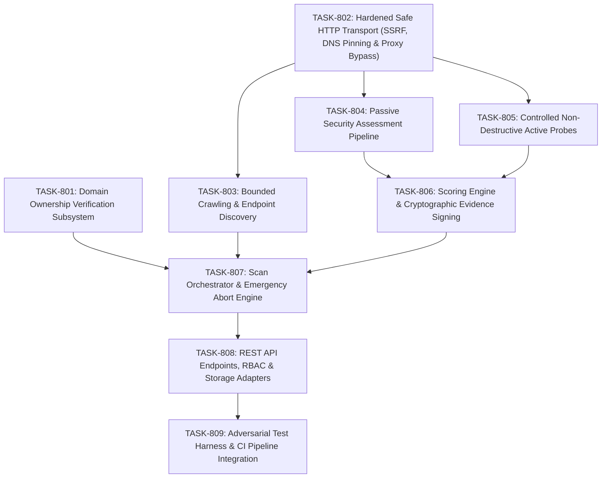

# VELTRIX: Phase 8 Task Breakdown — Authorized Website Vulnerability Assessment

**Document Version:** 1.2.0 (PR #17 Architecture Reconciliation & TASK-802 Preparation)  
**Phase:** Phase 8 (Architecture & Planning)  
**Classification:** Engineering Task Breakdown & Work Breakdown Structure (WBS)  
**Status:** IN REVIEW (PR #17 Architecture Reconciliation)  
**Authors:** VELTRIX Core Security Team  

---

## 1. Phase 8 Overview & Task Roadmap

Phase 8 implements the Authorized Website Vulnerability Assessment Engine. Work is broken down into 9 sequential, self-contained tasks designed to maintain backward compatibility, strictly preserve Phase 7 evidence authority boundaries, and guarantee safety invariants.

---

## 2. Granular Task Specifications

### TASK-801: Domain Ownership Verification Subsystem
- **Priority:** P0 (Blocker)  
- **Complexity:** Medium (3 SP)  
- **Dependencies:** None  
- **Status:** COMPLETED (Merged in PR #15 & PR #16)  
- **Description:** Implement the multi-method domain ownership verification subsystem that establishes cryptographic authorization prior to any scanning activity. Integrates with existing `backend/src/services/domain-verification.ts` and `backend/src/routes/websites.ts`.
- **Key Deliverables:**
  - `backend/src/scanner/verification/verifier.ts`
  - `backend/src/scanner/verification/dns-verifier.ts`
  - `backend/src/scanner/verification/http-verifier.ts`
  - `backend/src/scanner/verification/meta-verifier.ts`
- **Acceptance Criteria:**
  1. Generates unique, cryptographically random verification tokens (`vltx_tok_<32Hex>`).
  2. Implements DNS TXT challenge resolution using authoritative DNS queries.
  3. Implements HTTP challenge file verification at `/.well-known/veltrix-challenge/<token>`.
  4. Implements HTML `<meta name="veltrix-site-verification">` challenge parsing.
  5. Enforces 90-day authorization lifetime, 7-day grace period, and expiration transitions.
  6. Enforces tenant domain uniqueness constraint to prevent cross-tenant domain hijacking via DynamoDB transactional writes (`PK = DOMAIN#{domain}`, `SK = OWNERSHIP`).
  7. Enforces connection-level IP pinning, strict IPv6 parsing, zone identifier rejection, and positive IPv6 global-unicast policy (`2000::/3`) on HTTP verification fetcher.

---

### TASK-802: Hardened Safe HTTP Transport Layer (`SafeHttpClient`)
- **Priority:** P0 (Blocker)  
- **Complexity:** High (5 SP)  
- **Dependencies:** None (Builds on TASK-801 verification foundation)  
- **Status:** COMPLETED (Implemented in PR #18)  
- **Description:** Implement custom Node.js `http.Agent` and `https.Agent` egress transport layer that enforces SSRF filtering, connection-level socket IP pinning, ambient proxy bypass, separate request authorization contexts (`VerificationScopeGuard` vs `AuthorizedScanScopeGuard`), strict hop-by-hop redirect validation, independent streaming decompression safeguards, and tenant-scoped emergency abort.
- **Key Deliverables:**
  - `backend/src/scanner/transport/types.ts`
  - `backend/src/scanner/transport/safe-http-client.ts`
  - `backend/src/scanner/transport/ip-validator.ts` (planned shared IPv4/IPv6 validator extraction, backward-compatible re-exports in `http-verifier.ts`)
  - `backend/src/scanner/transport/dns-resolver.ts`
  - `backend/src/scanner/transport/socket-connector.ts`
  - `backend/src/scanner/transport/redirect-handler.ts`
  - `backend/src/scanner/transport/stream-decompressor.ts`
- **Acceptance Criteria:**
  1. **Dual Scope Guards & Request Contexts**:
     - `VerificationScopeGuard` (`DOMAIN_OWNERSHIP_VERIFICATION`): Permitted exclusively for registered domain challenge paths (`/.well-known/veltrix-challenge/<token>` and root `/` HTML meta-tag); operates before asset achieves VERIFIED status (zero circular dependency); strictly forbids redirects (`maxRedirects = 0`); rejects non-challenge paths with `VERIFICATION_PATH_UNAUTHORIZED`.
     - `AuthorizedScanScopeGuard` (`AUTHORIZED_SCAN`): Requires verified, unexpired, non-blocked domain ownership (`status === 'VERIFIED'`, `!scanBlocked`, `expiresAt > Date.now()`). Enforces exact approved host allowlist (exact FQDN match; wildcards strictly forbidden) and path exclusions. Evaluated before DNS resolution and connection.
     - Contexts are server-derived via trusted internal services; untrusted API clients cannot select request purpose or forge context.
  2. **SSRF & IP Validation**:
     - Preserves all TASK-801 protections: canonical IPv4 normalization (octal/hex/dword), strict IPv6 parsing (requiring `missing >= 1` zero-compression, rejecting `%` zone IDs), positive `2000::/3` policy, preserved special exclusions (`2001::/23`, `2001:db8::/32`, `3fff::/20`), and 6to4 embedded IPv4 evaluation.
     - Fails closed immediately if ANY resolved DNS record is prohibited.
  3. **Connection-Level Socket IP Pinning & Proxy Isolation**:
     - Socket creation (`net.createConnection`) connects directly to validated pinned IP; agent `lookup` hook returns pinned IP. Zero secondary DNS lookups.
     - Ambient `HTTP_PROXY` / `HTTPS_PROXY` strictly ignored.
     - TLS SNI (`servername`) passed; certificate hostname validation enforced (`rejectUnauthorized: true`).
  4. **Strict Redirect Policy**:
     - Default `maxRedirects = 0`. Domain verification never follows redirects.
     - Authorized scanning follows redirects only with explicit policy & `AuthorizedScanScopeGuard`; every hop undergoes URL validation, DNS resolution, full IP validation, and scope verification.
     - Strictly rejects HTTPS-to-HTTP downgrade. Detects loops (`visitedUrls`) and enforces max 5 hops ceiling.
     - Strips `Authorization`, `Cookie`, and tenant-specific custom headers on cross-origin redirects.
  5. **HTTP Method & Outbound Port Policy**:
     - Ordinary scanner requests default to `GET` and `HEAD` only. Unrestricted `DELETE`, `PUT`, `PATCH`, `POST` are barred.
     - Non-GET/HEAD methods require an explicitly authorized operation policy designed for that probe.
     - Canonical port default: HTTP `80` and HTTPS `443`. Non-standard ports (e.g. `8080`, `8443`) require explicit server-controlled authorization. Internal service ports (22, 25, 3306, 5432, 6379, 27017, etc.) and prohibited destinations can never be bypassed via port allowlists.
  6. **Streaming Decompression & Resource Limits**:
     - Independent ceilings:
       - Compressed responses: max 2 MB raw compressed wire data, max 10 MB decompressed body data, max 100:1 expansion ratio (after 64 KB warm-up).
       - Identity / uncompressed responses: max 10 MB response body limit (2 MB compressed limit strictly excluded).
     - Never trusts `Content-Length` alone. Destroys stream and socket immediately if any ceiling is breached.
     - Handles unsupported or malformed encodings safely (fail closed).
  7. **Granular Timeouts & Tenant-Scoped Emergency Abort (500 ms SLO)**:
     - Enforces connection timeout (5s), response header timeout (10s), body idle timeout (15s), and total request timeout (30s).
     - Active sockets tracked in tenant-and-scan registry: `abortScan(orgId, scanId)` terminates all sockets for that specific scan within **500 ms** SLO with complete tenant isolation.
     - Concurrent scans across different tenants with identical scan IDs remain strictly isolated.
     - Process-wide abort reserved exclusively for process shutdown or host emergency.
  8. **Connection Reuse**:
     - Disabled cross-request reuse by default (`keepAlive: false`, `Connection: close`).
     - Future pooling strictly keyed by `(orgId, scanId, destinationHost, pinnedIp, port, tlsIdentity)`. Never pooled across tenants.

---

### TASK-803: Bounded Crawling & Endpoint Discovery Engine
- **Priority:** P1  
- **Complexity:** Medium (3 SP)  
- **Dependencies:** TASK-802  
- **Description:** Build a safe, bounded BFS/DFS web crawler to discover application endpoints without crossing domain boundaries or submitting mutating requests.
- **Key Deliverables:**
  - `backend/src/scanner/crawler/crawler.ts`
  - `backend/src/scanner/crawler/url-normalizer.ts`
  - `backend/src/scanner/crawler/html-link-extractor.ts`
  - `backend/src/scanner/crawler/scope-guard.ts`
- **Acceptance Criteria:**
  1. Traverses links using Breadth-First Search up to configurable `maxDepth` (default 3, max 5).
  2. Extracts URLs from HTML `<a>`, `<form action>`, `<script src>`, and `<link href>`.
  3. Canonicalizes URLs (strips fragments, normalizes query param ordering, removes session IDs).
  4. Issues `GET` and `HEAD` requests only. Never submits forms or mutation methods.
  5. Enforces strict boundary: drops URLs outside `allowedHosts` or matching `excludedPaths`.
  6. Halts cleanly when configured `maxPages` ceiling is reached.

---

### TASK-804: Passive Security Assessment Pipeline
- **Priority:** P1  
- **Complexity:** Medium (3 SP)  
- **Dependencies:** TASK-802  
- **Description:** Implement zero-intrusion passive security inspection rules evaluating TLS configuration, HTTP security headers, cookie security flags, and banner disclosures.
- **Key Deliverables:**
  - `backend/src/scanner/analyzers/passive-analyzer.ts`
  - `backend/src/scanner/rules/passive/tls-rule.ts`
  - `backend/src/scanner/rules/passive/security-headers-rule.ts`
  - `backend/src/scanner/rules/passive/cookie-flags-rule.ts`
  - `backend/src/scanner/rules/passive/banner-disclosure-rule.ts`
- **Acceptance Criteria:**
  1. Flags obsolete TLS protocols (TLS 1.0, TLS 1.1) and certificates expiring within 14 days.
  2. Validates HSTS (`max-age`, `includeSubDomains`), CSP (`unsafe-inline`, `unsafe-eval`), `X-Frame-Options`, `X-Content-Type-Options`, and `Referrer-Policy`.
  3. Evaluates all `Set-Cookie` headers for `Secure`, `HttpOnly`, and `SameSite` flags.
  4. Identifies information disclosure via `Server`, `X-Powered-By`, debug paths, or stack traces.
  5. Operates with zero extra requests beyond the initial crawl response.

---

### TASK-805: Controlled Non-Destructive Active Security Probes
- **Priority:** P1  
- **Complexity:** High (5 SP)  
- **Dependencies:** TASK-802, TASK-803  
- **Description:** Implement plugin-based active security probes using harmless, non-destructive canaries to identify common web vulnerabilities without causing side effects.
- **Key Deliverables:**
  - `backend/src/scanner/analyzers/active-analyzer.ts`
  - `backend/src/scanner/rules/active/xss-canary-rule.ts`
  - `backend/src/scanner/rules/active/sqli-anomaly-rule.ts`
  - `backend/src/scanner/rules/active/open-redirect-rule.ts`
  - `backend/src/scanner/rules/active/path-traversal-rule.ts`
- **Acceptance Criteria:**
  1. Dispatches non-executable alphanumeric canaries to detect unencoded reflection (XSS).
  2. Analyzes reflection context (HTML text, attribute, script) rather than relying on HTTP status.
  3. Sends benign quote disruptors (`'`, `"`) to detect unhandled SQL syntax error signatures without executing data modification or extraction.
  4. Validates open redirects by checking `Location` header destinations on `3xx` responses.
  5. Submits harmless traversal canaries to detect path normalization flaws.
  6. Never issues SQL `DROP`, `DELETE`, `UPDATE`, or destructive DoS payloads.

---

### TASK-806: Severity Scoring & Cryptographic Evidence Signing
- **Priority:** P0 (Core Integrity)  
- **Complexity:** Medium (3 SP)  
- **Dependencies:** TASK-804, TASK-805  
- **Description:** Implement multi-factor severity/confidence scoring and integrate with Phase 7 `InternalEvidenceAuthority` using `createContext()` with approved verifier `'core-scanner:active-audit'`.
- **Key Deliverables:**
  - `backend/src/scanner/scoring/scoring-engine.ts`
  - `backend/src/scanner/scoring/cvss-calculator.ts`
  - `backend/src/scanner/evidence/evidence-collector.ts`
  - `backend/src/scanner/evidence/secret-scrubber.ts`
- **Acceptance Criteria:**
  1. Computes CVSS v3.1 base score and assigns confidence tier (`CONFIRMED`, `HIGH`, `MEDIUM`, `LOW`).
  2. Implements differential baseline comparison to suppress false positives.
  3. Scrubs sensitive secrets (Authorization tokens, cookies, passwords, API keys) from stored evidence and reproduction curl commands.
  4. Truncates response excerpts to 64 KB maximum.
  5. Generates `InternalTrustedEvidenceContext` signed via `InternalEvidenceAuthority.prototype.createContext()`.

---

### TASK-807: Scan Orchestration, Worker Queue & Emergency Abort Engine
- **Priority:** P0 (Safety & Reliability)  
- **Complexity:** High (5 SP)  
- **Dependencies:** TASK-801, TASK-802, TASK-806  
- **Description:** Build the scan job scheduler, token-bucket rate limiter, concurrency controller, and sub-500ms emergency abort coordinator.
- **Key Deliverables:**
  - `backend/src/scanner/orchestration/scan-orchestrator.ts`
  - `backend/src/scanner/orchestration/scan-worker.ts`
  - `backend/src/scanner/orchestration/rate-limiter.ts`
  - `backend/src/scanner/orchestration/abort-coordinator.ts`
- **Acceptance Criteria:**
  1. Enforces rate limits (1–20 RPS) using token-bucket algorithm with backoff on HTTP 429/503.
  2. Enforces concurrency caps: max 1 scan per website asset, max 3 active scans per organization.
  3. Implements atomic job claiming via conditional database updates.
  4. Coordinates emergency abort: terminates active socket pool within **500 ms** SLO upon abort trigger or website authorization revocation.
  5. Implements 10-second timeout watchdog for unresponsive workers with task kill escalation.

---

### TASK-808: REST API Endpoints, RBAC & Storage Adapters
- **Priority:** P1  
- **Complexity:** Medium (4 SP)  
- **Dependencies:** TASK-801, TASK-807  
- **Description:** Expose the scan management, verification, findings, and reporting REST endpoints with canonical production RBAC (`SUPER_ADMIN`, `ORG_ADMIN`, `SECURITY_ANALYST`, `READ_ONLY_VIEWER`, `AUDITOR`) and DynamoDB / MemoryStore persistence.
- **Key Deliverables:**
  - `backend/src/routes/websites.ts` (existing router extension)
  - `backend/src/routes/scans.ts`
  - `backend/src/routes/findings.ts`
  - `backend/src/scanner/storage/scanner-storage.ts`
- **Acceptance Criteria:**
  1. Implements all REST endpoints defined in `specs/phase-8-api-contracts.md` conforming to `ApiResponse<T>` and `ApiErrorResponse`.
  2. Enforces canonical production RBAC roles (`SUPER_ADMIN`, `ORG_ADMIN`, `SECURITY_ANALYST`, `READ_ONLY_VIEWER`, `AUDITOR`).
  3. Implements DynamoDB table operations with exact index names (`GSI1-StatusDomain`, `GSI2-DomainLookup`, `GSI1-SiteScans`, `GSI2-ScanFindings`).
  4. Ensures full parity in `MemoryStore` for local development and test execution.
  5. Emits structured audit events to `AuditLog` on all administrative and scan state changes.

---

### TASK-809: Adversarial Test Harness & CI Pipeline Integration
- **Priority:** P0 (Verification)  
- **Complexity:** High (5 SP)  
- **Dependencies:** TASK-801 through TASK-808  
- **Description:** Build the comprehensive automated test suite, including mock vulnerable web servers, SSRF attack matrices, DNS rebinding harnesses, and CI gates.
- **Key Deliverables:**
  - `backend/tests/scanner/verification.test.ts`
  - `backend/tests/scanner/safe-transport.test.ts`
  - `backend/tests/scanner/dns-rebinding.test.ts`
  - `backend/tests/scanner/zip-bomb.test.ts`
  - `backend/tests/scanner/abort-slo.test.ts`
  - `backend/tests/scanner/scan-lifecycle.test.ts`
- **Acceptance Criteria:**
  1. 100% test pass rate across all new scanner unit, integration, and security suites.
  2. SSRF attack matrix proves rejection across 100% of IPv4/IPv6 private/metadata variations and alternate encodings.
  3. Verified DNS rebinding mitigation using alternating in-process DNS server and socket IP pinning.
  4. Verified sub-500ms emergency abort latency under simulated high-load conditions and domain revocation.
  5. Confirms production build (`backend/dist`) contains zero test code and passes automated CI check.

---

## 3. Merge Readiness Checklist

Before merging Phase 8 implementation:
- [ ] All 7 specification documents reviewed and approved by security leads.
- [ ] Domain verification strictly gates all scan creation and execution (`status === 'VERIFIED'`, `!scanBlocked`, `expiresAt > Date.now()`).
- [ ] Safe transport layer achieves 100% test pass rate across SSRF/rebinding attack matrix and ignores ambient proxies.
- [ ] Non-destructive active checks confirmed to contain zero mutating SQL/file operations.
- [ ] Evidence provenance cryptographically verified via Phase 7 `InternalEvidenceAuthority.prototype.createContext()`.
- [ ] Secret scrubber verified to redact credentials from reproduction curl commands and evidence headers.
- [ ] Emergency abort verified to terminate sockets within 500 ms SLO.
- [ ] Monorepo passes typecheck, build, lint, and all test suites with zero failures.
- [ ] Automated CI production artifact exclusion check confirms zero test utilities in `dist`.
