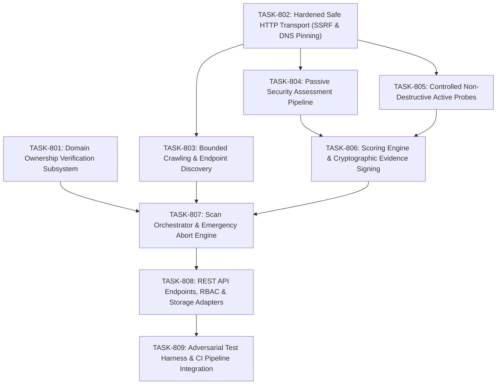

# VELTRIX: Phase 8 Task Breakdown — Authorized Website Vulnerability Assessment

**Document Version:** 1.0.0  
**Phase:** Phase 8 (Architecture & Planning)  
**Classification:** Engineering Task Breakdown & Work Breakdown Structure (WBS)  
**Status:** DRAFT / IN REVIEW  
**Authors:** VELTRIX Core Security Team  

---

## 1. Phase 8 Overview & Task Roadmap

Phase 8 implements the Authorized Website Vulnerability Assessment Engine. Work is broken down into 9 sequential, self-contained tasks designed to maintain backward compatibility, strictly preserve Phase 7 evidence authority boundaries, and guarantee safety invariants.

---

## 2. Granular Task Specifications

### TASK-801: Domain Ownership Verification Subsystem
- **Priority:** P0 (Blocker)  
- **Complexity:** Medium (3 SP)  
- **Dependencies:** None  
- **Description:** Implement the multi-method domain ownership verification subsystem that establishes cryptographic authorization prior to any scanning activity.
- **Key Deliverables:**
  - `backend/src/scanner/verification/verifier.ts`
  - `backend/src/scanner/verification/dns-verifier.ts`
  - `backend/src/scanner/verification/http-verifier.ts`
  - `backend/src/scanner/verification/meta-verifier.ts`
- **Acceptance Criteria:**
  1. Generates unique, cryptographically random verification tokens (`vltx_tok_<32Hex>`).
  2. Implements DNS TXT challenge resolution using authoritative DNS queries.
  3. Implements HTTP challenge file verification at `/.well-known/veltrix-challenge/<token>`.
  4. Implements HTML `<meta name="veltrix-site-verification">` challenge parsing.
  5. Enforces 90-day authorization lifetime, 7-day grace period, and expiration transitions.
  6. Enforces tenant domain uniqueness constraint to prevent cross-tenant domain hijacking.

---

### TASK-802: Hardened Safe HTTP Transport Layer (`SafeHttpClient`)
- **Priority:** P0 (Blocker)  
- **Complexity:** High (5 SP)  
- **Dependencies:** None  
- **Description:** Implement custom Node.js `http.Agent` and `https.Agent` overrides that enforce SSRF filtering, socket-level IP pinning, hop-by-hop redirect validation, and stream safeguards.
- **Key Deliverables:**
  - `backend/src/scanner/transport/safe-http-client.ts`
  - `backend/src/scanner/transport/ip-validator.ts`
  - `backend/src/scanner/transport/dns-resolver.ts`
  - `backend/src/scanner/transport/redirect-handler.ts`
- **Acceptance Criteria:**
  1. Validates all resolved IPv4 and IPv6 addresses against private, loopback, link-local, carrier-grade NAT, and cloud metadata ranges (`169.254.169.254`).
  2. Directs socket creation (`net.createConnection`) to the validated, pinned IP address, completely eliminating Time-Of-Check to Time-Of-Use (TOCTOU) DNS rebinding.
  3. Preserves original hostname for TLS SNI and certificate hostname verification.
  4. Intercepts `3xx` redirects at each hop, validating destination host and IP before issuing subsequent requests (max 5 hops).
  5. Implements response decompression stream limits (max 10 MB) to prevent zip bombs.
  6. Enforces connection timeout (5s), response header timeout (10s), and body idle timeout (15s).

---

### TASK-803: Bounded Crawling & Endpoint Discovery Engine
- **Priority:** P1  
- **Complexity:** Medium (3 SP)  
- **Dependencies:** TASK-802  
- **Description:** Build a safe, bounded BFS/DFS web crawler to discover application endpoints without crossing domain boundaries or submitting mutating requests.
- **Key Deliverables:**
  - `backend/src/scanner/crawler/crawler.ts`
  - `backend/src/scanner/crawler/url-normalizer.ts`
  - `backend/src/scanner/crawler/html-link-extractor.ts`
  - `backend/src/scanner/crawler/scope-guard.ts`
- **Acceptance Criteria:**
  1. Traverses links using Breadth-First Search up to configurable `maxDepth` (default 3, max 5).
  2. Extracts URLs from HTML `<a>`, `<form action>`, `<script src>`, and `<link href>`.
  3. Canonicalizes URLs (strips fragments, normalizes query param ordering, removes session IDs).
  4. Issues `GET` and `HEAD` requests only. Never submits forms or mutation methods.
  5. Enforces strict boundary: drops URLs outside `allowedHosts` or matching `excludedPaths`.
  6. Halts cleanly when configured `maxPages` ceiling is reached.

---

### TASK-804: Passive Security Assessment Pipeline
- **Priority:** P1  
- **Complexity:** Medium (3 SP)  
- **Dependencies:** TASK-802  
- **Description:** Implement zero-intrusion passive security inspection rules evaluating TLS configuration, HTTP security headers, cookie security flags, and banner disclosures.
- **Key Deliverables:**
  - `backend/src/scanner/analyzers/passive-analyzer.ts`
  - `backend/src/scanner/rules/passive/tls-rule.ts`
  - `backend/src/scanner/rules/passive/security-headers-rule.ts`
  - `backend/src/scanner/rules/passive/cookie-flags-rule.ts`
  - `backend/src/scanner/rules/passive/banner-disclosure-rule.ts`
- **Acceptance Criteria:**
  1. Flags obsolete TLS protocols (TLS 1.0, TLS 1.1) and certificates expiring within 14 days.
  2. Validates HSTS (`max-age`, `includeSubDomains`), CSP (`unsafe-inline`, `unsafe-eval`), `X-Frame-Options`, `X-Content-Type-Options`, and `Referrer-Policy`.
  3. Evaluates all `Set-Cookie` headers for `Secure`, `HttpOnly`, and `SameSite` flags.
  4. Identifies information disclosure via `Server`, `X-Powered-By`, debug paths, or stack traces.
  5. Operates with zero extra requests beyond the initial crawl response.

---

### TASK-805: Controlled Non-Destructive Active Security Probes
- **Priority:** P1  
- **Complexity:** High (5 SP)  
- **Dependencies:** TASK-802, TASK-803  
- **Description:** Implement plugin-based active security probes using harmless, non-destructive canaries to identify common web vulnerabilities without causing side effects.
- **Key Deliverables:**
  - `backend/src/scanner/analyzers/active-analyzer.ts`
  - `backend/src/scanner/rules/active/xss-canary-rule.ts`
  - `backend/src/scanner/rules/active/sqli-anomaly-rule.ts`
  - `backend/src/scanner/rules/active/open-redirect-rule.ts`
  - `backend/src/scanner/rules/active/path-traversal-rule.ts`
- **Acceptance Criteria:**
  1. Dispatches non-executable alphanumeric canaries to detect unencoded reflection (XSS).
  2. Analyzes reflection context (HTML text, attribute, script) rather than relying on HTTP status.
  3. Sends benign quote disruptors (`'`, `"`) to detect unhandled SQL syntax error signatures without executing data modification or extraction.
  4. Validates open redirects by checking `Location` header destinations on `3xx` responses.
  5. Submits harmless traversal canaries to detect path normalization flaws.
  6. Never issues SQL `DROP`, `DELETE`, `UPDATE`, or destructive DoS payloads.

---

### TASK-806: Severity Scoring & Cryptographic Evidence Signing
- **Priority:** P0 (Core Integrity)  
- **Complexity:** Medium (3 SP)  
- **Dependencies:** TASK-804, TASK-805  
- **Description:** Implement multi-factor severity/confidence scoring and integrate with Phase 7 `InternalEvidenceAuthority` to cryptographically sign all vulnerability evidence.
- **Key Deliverables:**
  - `backend/src/scanner/scoring/scoring-engine.ts`
  - `backend/src/scanner/scoring/cvss-calculator.ts`
  - `backend/src/scanner/evidence/evidence-collector.ts`
  - `backend/src/scanner/evidence/secret-scrubber.ts`
- **Acceptance Criteria:**
  1. Computes CVSS v3.1 base score and assigns confidence tier (`CONFIRMED`, `HIGH`, `MEDIUM`, `LOW`).
  2. Implements differential baseline comparison to suppress false positives.
  3. Scrubs sensitive secrets (Authorization tokens, cookies, passwords, API keys) from stored evidence.
  4. Truncates response excerpts to 64 KB maximum.
  5. Generates `EvidenceContext` and cryptographically signs it via `InternalEvidenceAuthority.prototype.signEvidencePayload()`.

---

### TASK-807: Scan Orchestration, Worker Queue & Emergency Abort Engine
- **Priority:** P0 (Safety & Reliability)  
- **Complexity:** High (5 SP)  
- **Dependencies:** TASK-801, TASK-802, TASK-806  
- **Description:** Build the scan job scheduler, token-bucket rate limiter, concurrency controller, and sub-500ms emergency abort coordinator.
- **Key Deliverables:**
  - `backend/src/scanner/orchestration/scan-orchestrator.ts`
  - `backend/src/scanner/orchestration/scan-worker.ts`
  - `backend/src/scanner/orchestration/rate-limiter.ts`
  - `backend/src/scanner/orchestration/abort-coordinator.ts`
- **Acceptance Criteria:**
  1. Enforces rate limits (1–20 RPS) using token-bucket algorithm with backoff on HTTP 429/503.
  2. Enforces concurrency caps: max 1 scan per website asset, max 3 active scans per organization.
  3. Implements atomic job claiming via conditional database updates.
  4. Coordinates emergency abort: terminates active socket pool within **500 ms** SLO upon abort trigger.
  5. Implements 10-second timeout watchdog for unresponsive workers with task kill escalation.

---

### TASK-808: REST API Endpoints, RBAC & Storage Adapters
- **Priority:** P1  
- **Complexity:** Medium (4 SP)  
- **Dependencies:** TASK-801, TASK-807  
- **Description:** Expose the scan management, verification, findings, and reporting REST endpoints with strict RBAC and DynamoDB / MemoryStore persistence.
- **Key Deliverables:**
  - `backend/src/api/routes/websites.ts`
  - `backend/src/api/routes/scans.ts`
  - `backend/src/api/routes/findings.ts`
  - `backend/src/scanner/storage/scanner-storage.ts`
- **Acceptance Criteria:**
  1. Implements all REST endpoints defined in `specs/phase-8-api-contracts.md`.
  2. Enforces RBAC permissions (`SECURITY_ADMIN`, `SECURITY_ANALYST`, `SECURITY_VIEWER`).
  3. Implements DynamoDB single-table/multi-table operations with conditional writes.
  4. Ensures full parity in `MemoryStore` for local development and test execution.
  5. Emits structured audit events to `AuditLog` on all administrative and scan state changes.

---

### TASK-809: Adversarial Test Harness & CI Pipeline Integration
- **Priority:** P0 (Verification)  
- **Complexity:** High (5 SP)  
- **Dependencies:** TASK-801 through TASK-808  
- **Description:** Build the comprehensive automated test suite, including mock vulnerable web servers, SSRF attack matrices, DNS rebinding harnesses, and CI gates.
- **Key Deliverables:**
  - `backend/tests/scanner/verification.test.ts`
  - `backend/tests/scanner/safe-transport.test.ts`
  - `backend/tests/scanner/dns-rebinding.test.ts`
  - `backend/tests/scanner/zip-bomb.test.ts`
  - `backend/tests/scanner/abort-slo.test.ts`
  - `backend/tests/scanner/scan-lifecycle.test.ts`
- **Acceptance Criteria:**
  1. 100% test pass rate across all new scanner unit, integration, and security suites.
  2. SSRF attack matrix proves rejection across 100% of IPv4/IPv6 private/metadata variations.
  3. Verified DNS rebinding mitigation using alternating in-process DNS server.
  4. Verified sub-500ms emergency abort latency under simulated high-load conditions.
  5. Confirms production build (`backend/dist`) contains zero test code and passes CI check.

---

## 3. Merge Readiness Checklist

Before merging Phase 8 implementation:
- [ ] All 7 specification documents reviewed and approved by security leads.
- [ ] Domain verification strictly gates all scan creation and execution.
- [ ] Safe transport layer achieves 100% test pass rate across SSRF/rebinding attack matrix.
- [ ] Non-destructive active checks confirmed to contain zero mutating SQL/file operations.
- [ ] Evidence provenance cryptographically verified via Phase 7 `InternalEvidenceAuthority`.
- [ ] Emergency abort verified to terminate sockets within 500 ms SLO.
- [ ] Monorepo passes typecheck, build, lint, and all test suites with zero failures.
- [ ] Automated CI production artifact exclusion check confirms zero test utilities in `dist`.
