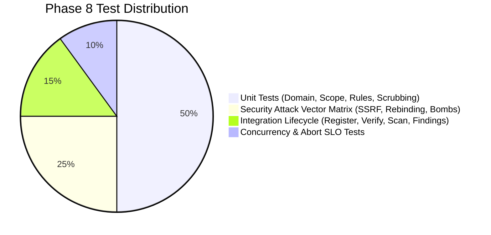

# VELTRIX: Phase 8 Testing Strategy — Authorized Website Vulnerability Assessment

**Document Version:** 1.1.0 (Architecture Review Hardened)  
**Phase:** Phase 8 (Architecture & Planning)  
**Classification:** Quality Assurance & Security Validation  
**Status:** DRAFT / IN REVIEW (PR #14 Consistency Review)  
**Authors:** VELTRIX Core Security Team  

---

## 1. Testing Philosophy & Verification Principles

The Phase 8 Vulnerability Assessment Engine involves executing live network requests, parsing potentially untrusted external payloads, and producing high-consequence security findings. A failure in testing can lead to catastrophic security regressions (e.g., SSRF into cloud metadata) or severe operational disruption to customer websites.

Testing must adhere to the following principles:
1. **Isolated Execution:** No test in the automated CI/CD pipeline shall ever issue an outbound network request to an external third-party internet domain or AWS service. All external systems, DNS servers, and targets are fully emulated using local in-process test servers.
2. **Adversarial Negative Testing:** Every security control (SSRF filter, DNS pinning, redirect guard, scope boundary, decompressor, proxy bypass) must be exercised against comprehensive attack vector payloads.
3. **Deterministic Evidence Verification:** All tests asserting vulnerability discovery must verify that the Phase 7 `InternalEvidenceAuthority` generated a valid, verifiable cryptographic signature over the finding's `InternalTrustedEvidenceContext` using the approved verifier identity `'core-scanner:active-audit'`.
4. **SLO Verification:** Emergency abort operations must be deterministically benchmarked to guarantee socket teardown within the **500 ms** target SLO.

---

## 2. Test Pyramid & Coverage Requirements

### Coverage Targets:
- **Security Boundary Logic (`ScopeGuard`, `SafeHttpClient`, IP filter):** **100%** statement and branch coverage.
- **Rule Evaluators (Passive & Active Analyzers):** **>95%** statement coverage.
- **API Controllers & Data Access:** **>90%** statement coverage.

---

## 3. Unit Test Suite Breakdown

### 3.1 Domain Ownership Verification Tests (`tests/unit/verification.test.ts`)
- **DNS TXT Verification:**
  - Valid TXT record containing exact tenant ID and token $\to$ returns `VERIFIED`.
  - Missing TXT record $\to$ returns `CHALLENGE_VERIFICATION_FAILED`.
  - Mismatched token or wrong organization ID $\to$ returns `CHALLENGE_VERIFICATION_FAILED`.
  - DNS resolution error or timeout $\to$ fails closed with `CHALLENGE_VERIFICATION_FAILED`.
- **HTTP Challenge Verification:**
  - Mock HTTP server returns correct JSON token at `/.well-known/veltrix-challenge/<token>` $\to$ returns `VERIFIED`.
  - Server returns 404, 500, or invalid JSON $\to$ returns `CHALLENGE_VERIFICATION_FAILED`.
  - Target URL resolves to an internal/private IP $\to$ caught by SSRF filter, returns `SSRF_BLOCKED`.
- **HTML Meta Tag Verification:**
  - HTML contains `<meta name="veltrix-site-verification" content="<token>">` $\to$ returns `VERIFIED`.
  - Missing meta tag, malformed HTML, or mismatched token $\to$ returns `CHALLENGE_VERIFICATION_FAILED`.
- **Expiry, Grace Period & Revocation Lifecycle:**
  - Site at 80 days $\to$ active and valid for scans.
  - Site at 85 days $\to$ marked `GRACE_PERIOD`, `scanBlocked: true`, scans blocked with `DOMAIN_VERIFICATION_SUSPENDED`.
  - Site at 91 days $\to$ marked `EXPIRED`, `scanBlocked: true`, scans rejected with `DOMAIN_NOT_VERIFIED`.
  - `POST /websites/:siteId/revoke` $\to$ sets `status: 'GRACE_PERIOD'`, `scanBlocked: true`, and immediately cancels active scans.

### 3.2 Scope & Exclusion Guard Tests (`tests/unit/scope-guard.test.ts`)
- **Allowed Hosts:**
  - Request to `primaryDomain` $\to$ allowed.
  - Request to `approvedSubdomains` $\to$ allowed.
  - Request to unapproved subdomain (e.g., `attacker.example.com` or `other.com`) $\to$ rejected.
  - Port validation (permit 80, 443; reject arbitrary high ports unless whitelisted).
- **Excluded Paths:**
  - Exact match (`/logout`) $\to$ dropped.
  - Regex match (`^/admin/.*`) $\to$ dropped.
  - Query parameter edge cases (`/app?next=/logout`) $\to$ path normalized and evaluated safely.

### 3.3 Safe HTTP Transport & SSRF Filter Tests (`backend/tests/scanner/safe-transport.test.ts`)
- **Request Authorization Context Separation:**
  - `DOMAIN_OWNERSHIP_VERIFICATION` context allows request to challenge path (`/.well-known/veltrix-challenge/<token>`) even when asset status is `PENDING` / unverified (verifies zero circular dependency).
  - `DOMAIN_OWNERSHIP_VERIFICATION` context rejects requests to non-challenge paths (e.g., `/admin`, `/api`) and strictly blocks 3xx redirects (`maxRedirects = 0`).
  - `AUTHORIZED_SCAN` context rejects requests if asset status is `GRACE_PERIOD`, `EXPIRED`, `SUSPENDED`, or `REVOKED`, or if `scanBlocked: true`.
  - Rejects attempts by callers to supply forged or unverified authorization context tokens.
  - Scope and authorization evaluation executes **before** DNS queries and socket connection.
- **HTTP Method & Outbound Port Policy:**
  - `GET` and `HEAD` requests permitted by default.
  - `DELETE`, `PUT`, `PATCH`, and `POST` rejected with `METHOD_NOT_PERMITTED` unless an explicit probe authorization policy is attached.
  - Standard ports 80 and 443 permitted; arbitrary non-standard ports (e.g., 8080, 8443, 22, 3306) rejected unless explicitly authorized in asset configuration.
- **Comprehensive IP Address Denylist Matrix:**
  | Input | Representation | Classification | Expected Result |
  | :--- | :--- | :--- | :--- |
  | `127.0.0.1` | Standard IPv4 | Loopback | **REJECTED (`SSRF_BLOCKED`)** |
  | `127.127.127.127` | Subnet IPv4 | Loopback Range | **REJECTED (`SSRF_BLOCKED`)** |
  | `0177.0.0.1` | Octal IPv4 | Loopback | **REJECTED (`SSRF_BLOCKED`)** |
  | `0x7f.0.0.1` | Hex IPv4 | Loopback | **REJECTED (`SSRF_BLOCKED`)** |
  | `2130706433` | Dword / Integer | Loopback | **REJECTED (`SSRF_BLOCKED`)** |
  | `127.1` | Zero-compressed | Loopback | **REJECTED (`SSRF_BLOCKED`)** |
  | `10.0.0.1` | Standard IPv4 | RFC 1918 Private | **REJECTED (`SSRF_BLOCKED`)** |
  | `172.16.0.1` | Standard IPv4 | RFC 1918 Private | **REJECTED (`SSRF_BLOCKED`)** |
  | `192.168.1.1` | Standard IPv4 | RFC 1918 Private | **REJECTED (`SSRF_BLOCKED`)** |
  | `169.254.169.254` | Standard IPv4 | AWS IMDS Metadata | **REJECTED (`SSRF_BLOCKED`)** |
  | `100.64.0.1` | Standard IPv4 | Carrier-Grade NAT | **REJECTED (`SSRF_BLOCKED`)** |
  | `0.0.0.0` | Standard IPv4 | Current Network | **REJECTED (`SSRF_BLOCKED`)** |
  | `::1` | IPv6 | Loopback | **REJECTED (`SSRF_BLOCKED`)** |
  | `fe80::1` | IPv6 | Link-Local | **REJECTED (`SSRF_BLOCKED`)** |
  | `fc00::1` | IPv6 | Unique Local | **REJECTED (`SSRF_BLOCKED`)** |
  | `::ffff:127.0.0.1` | IPv4-Mapped IPv6 | Loopback | **REJECTED (`SSRF_BLOCKED`)** |
  | `::ffff:169.254.169.254` | IPv4-Mapped IPv6 | AWS Metadata | **REJECTED (`SSRF_BLOCKED`)** |
  | `[fd00:ec2::254]` | IPv6 | AWS IMDSv6 | **REJECTED (`SSRF_BLOCKED`)** |
  | `4000::1` | IPv6 | Unallocated Non-2000::/3 | **REJECTED (`SSRF_BLOCKED`)** |
  | `fe00::1` | IPv6 | Reserved Non-2000::/3 | **REJECTED (`SSRF_BLOCKED`)** |
  | `::8.8.8.8` | IPv6 | Deprecated IPv4-Compatible | **REJECTED (`SSRF_BLOCKED`)** |
  | `2001:4860:1:2:3:4:5:6::` | IPv6 | Malformed Zero-Compression | **REJECTED (`SSRF_BLOCKED`)** |
  | `fe80::1%eth0` | IPv6 | Scoped Zone Identifier | **REJECTED (`SSRF_BLOCKED`)** |
  | `2002:7f00:0001::` | IPv6 (6to4) | Embedded Loopback 127.0.0.1 | **REJECTED (`SSRF_BLOCKED`)** |
  | `2002:a9fe:a9fe::` | IPv6 (6to4) | Embedded IMDS 169.254.169.254 | **REJECTED (`SSRF_BLOCKED`)** |
  | `93.184.216.34` | Standard IPv4 | Public Internet IP | **ALLOWED** |
  | `2606:2800:220:1:248:1893:25c8:1946` | Standard IPv6 | Public Global Unicast | **ALLOWED** |
  | `2002:5db8:d822::1` | IPv6 (6to4) | Embedded Public 93.184.216.34 | **ALLOWED** |
- **Proxy Isolation Test:**
  - Set `HTTP_PROXY=http://127.0.0.1:8080` and `HTTPS_PROXY=http://127.0.0.1:8080` in environment.
  - Verify `SafeHttpClient` bypasses proxy and connects directly to destination socket, preventing proxy-based SSRF.
- **Connection Reuse Isolation:**
  - Verify `keepAlive: false` and `Connection: close` are sent by default.
  - Verify sockets are never reused across requests from different tenants or scan scopes.

### 3.4 Hop-by-Hop Redirect Tests (`backend/tests/scanner/redirects.test.ts`)
- **Default Redirect Behavior:** When `maxRedirects` is not explicitly configured, verify client defaults to `0` redirects (returns 3xx response as-is).
- **Legitimate Redirect Chain:** `https://site.com/start` $\to$ `https://site.com/middle` $\to$ `https://site.com/end` $\to$ successfully followed up to 5 hops when redirect policy is active.
- **Max Hop Ceiling:** Chain with 6 hops $\to$ halts with `MAX_REDIRECTS_EXCEEDED`.
- **Redirect Loop:** `A` $\to$ `B` $\to$ `A` $\to$ halts with `REDIRECT_LOOP_DETECTED`.
- **SSRF Redirect Escapes:**
  - `https://site.com/auth` $\to$ `302 Location: http://169.254.169.254/latest/meta-data` $\to$ caught at hop 1 before connecting, returns `SSRF_BLOCKED`.
  - `https://site.com/api` $\to$ `302 Location: http://127.0.0.1:8080/admin` $\to$ caught at hop 1, returns `SSRF_BLOCKED`.
  - `https://site.com/test` $\to$ `302 Location: http://[::1]/` $\to$ caught at hop 1, returns `SSRF_BLOCKED`.
- **Scope & Cross-Tenant Escapes:**
  - Cross-origin redirect to unapproved domain: `https://site.com/out` $\to$ `302 Location: https://attacker.com` $\to$ blocked by `ScopeGuard` before DNS resolution.
  - Cross-subdomain redirect to approved subdomain: `https://site.com/app` $\to$ `302 Location: https://api.site.com` $\to$ allowed, but sensitive headers (`Authorization`, `Cookie`) are stripped.
- **Protocol Downgrade Ban:**
  - `https://site.com/secure` $\to$ `302 Location: http://site.com/insecure` $\to$ rejected immediately with `PROTOCOL_DOWNGRADE_BLOCKED`.

### 3.5 Bounded Crawler Tests (`tests/unit/crawler.test.ts`)
- Extracts valid links from HTML `<a>`, `<form action>`, `<script src>`, `<link href>`.
- Correctly skips image, video, zip, and binary links.
- Strips URL fragments (`#section-1`) and canonicalizes query parameters (`?b=2&a=1` $\to$ `?a=1&b=2`).
- Detects crawl traps and halts at configured `maxDepth` (e.g., 3) and `maxPages` (e.g., 250).

### 3.6 Security Rule Evaluator Tests (`tests/unit/analyzers.test.ts`)
- **Passive Rule Evaluators:**
  - TLS 1.0/1.1 response $\to$ flags `TLS_WEAK_PROTOCOL` finding.
  - Missing `Content-Security-Policy` $\to$ flags `MISSING_SECURITY_HEADER` finding.
  - Cookie without `HttpOnly` or `Secure` $\to$ flags `INSECURE_COOKIE_ATTRIBUTES` finding.
  - Banner `Server: Apache/2.2.8` $\to$ flags `SERVER_VERSION_DISCLOSURE`.
- **Active Rule Evaluators:**
  - Reflected XSS Canary: Canary string reflected verbatim into HTML body $\to$ flags `CROSS_SITE_SCRIPTING_REFLECTED` (`CONFIRMED`).
  - Reflected XSS Encoded: Canary reflected as `&lt;canary&gt;` $\to$ does NOT flag (correctly avoids false positive).
  - SQL Syntax Anomaly: Injected quote causes response with `ODBC Microsoft Access Driver` error $\to$ flags `SQL_INJECTION_SYNTAX_ANOMALY` (`HIGH`).
  - Open Redirect: Injected domain reflected in `Location` header on 302 response $\to$ flags `OPEN_REDIRECT_UNVALIDATED`.

### 3.7 Secret Scrubbing & Evidence Signing Tests (`tests/unit/evidence.test.ts`)
- Request containing `Authorization: Bearer secret-token-12345` $\to$ scrubbed to `Authorization: [REDACTED]`.
- Request containing `Cookie: session=xyz; password=secret` $\to$ scrubbed to `Cookie: session=[REDACTED]; password=[REDACTED]`.
- Reproduction curl containing `-H 'Authorization: Bearer xyz'` $\to$ sanitized to `-H 'Authorization: [REDACTED]'`.
- Stored body exceeding 64 KB $\to$ truncated with `[TRUNCATED_AT_64KB]`.
- Evidence signed via `InternalEvidenceAuthority.prototype.createContext()` with `'core-scanner:active-audit'` $\to$ signature validates; tampered evidence fails signature check.
- External API client attempting to inject `trustedEvidenceContext` via public `POST /api/v1/events` or `/api/v1/findings` $\to$ rejected with 400 Bad Request.

---

## 4. Adversarial Security Regression Test Suite

### 4.1 DNS Rebinding Simulation Harness (`tests/security/dns-rebinding.test.ts`)
- **Test Setup:**
  - Launch an in-process DNS server that alternates responses:
    - Query 1 for `rebind.test`: returns `198.51.100.1` (Public test IP).
    - Query 2 for `rebind.test`: returns `169.254.169.254` (Metadata IP).
- **Assertion:**
  - `SafeHttpClient` performs DNS resolution during pre-flight.
  - Socket `createConnection` connects strictly to the pinned IP (`198.51.100.1`).
  - The second DNS resolution is never triggered during connection establishment.
  - Rebinding attack is completely mitigated.

### 4.2 Decompression Bomb / Zip Bomb Harness (`backend/tests/scanner/zip-bomb.test.ts`)
- **Decompressed Size Ceiling:**
  - In-process HTTP server serves a small 10 KB gzip stream that decompresses into 500 MB of zeros.
  - Exactly at 10 MB uncompressed threshold, stream and underlying socket are destroyed with `MAX_RESPONSE_SIZE_EXCEEDED`.
  - Process memory remains bounded (<100 MB delta); worker does not crash.
- **Raw Compressed Data Ceiling:**
  - Server streams 5 MB of random compressed data.
  - Stream terminates immediately at 2 MB compressed ceiling with `MAX_RESPONSE_SIZE_EXCEEDED` before parsing finishes.
- **Compression Expansion Ratio Ceiling:**
  - In-process server sends a stream with 200:1 expansion ratio.
  - Stream transform terminates with `DECOMPRESSION_BOMB_DETECTED` after exceeding the 100:1 expansion limit.
- **Malformed & Unsupported Content-Encoding:**
  - Server sends invalid gzip header or unsupported compression algorithm (`content-encoding: zstd`).
  - Client safely fails closed without unhandled exceptions or socket leaks.

### 4.3 Slowloris / Hung Socket Harness (`backend/tests/scanner/slowloris.test.ts`)
- **Test Setup:**
  - In-process HTTP server accepts connection, sends 1 byte of header every 5 seconds.
- **Assertion:**
  - Connection/header timeout triggers at 10 seconds.
  - Socket is destroyed (`socket.destroy()`); worker moves to next endpoint without blocking.

### 4.4 Emergency Abort Latency & Tenant Isolation Benchmark (`backend/tests/scanner/abort-latency.test.ts`)
- **Multi-Tenant Setup:**
  - Launch Scan A (Tenant 1) with 10 long-polling requests.
  - Launch Scan B (Tenant 2) with 10 long-polling requests concurrently.
- **Execution & Invariant Verification:**
  - Issue `abortScan('scan-A')`.
  - High-resolution timer verifies that all sockets for Scan A are closed in **< 500 ms** SLO.
  - Scan A status reflects `ABORTED`.
  - **Tenant Isolation Invariant:** Scan B's sockets remain active and healthy; zero cross-tenant impact.
  - Active socket registry confirms 0 leaked sockets for Scan A.

---

## 5. Integration Test Plan (`tests/integration/scan-lifecycle.test.ts`)

Simulates the complete enterprise workflow from asset registration to reporting:
1. `POST /api/v1/websites`: Register `test-app.local` (returns challenge details).
2. `POST /api/v1/websites/:siteId/verify`: Verify via mock DNS TXT.
3. `POST /api/v1/scans`: Launch `STANDARD_ACTIVE` scan against local mock vulnerable server.
4. Scan worker executes crawl, runs passive analysis, executes canary active probes.
5. Findings are deduplicated, scored, and signed with `InternalEvidenceAuthority`.
6. Assert findings stored in `Veltrix-VulnerabilityFindings`:
   - 1x `CROSS_SITE_SCRIPTING_REFLECTED` (`CONFIRMED`, CVSS 7.5)
   - 1x `MISSING_SECURITY_HEADER` (`MEDIUM`, CVSS 5.0)
   - 1x `INSECURE_COOKIE_ATTRIBUTES` (`LOW`, CVSS 3.0)
7. Query `GET /api/v1/scans/:scanId/report`: Validates report structure and cryptographic verification status.
8. Assert audit log contains `WEBSITE_REGISTERED`, `WEBSITE_VERIFIED`, `SCAN_STARTED`, `FINDING_DISCOVERED`, and `SCAN_COMPLETED`.
