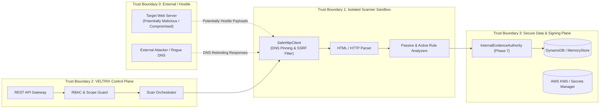
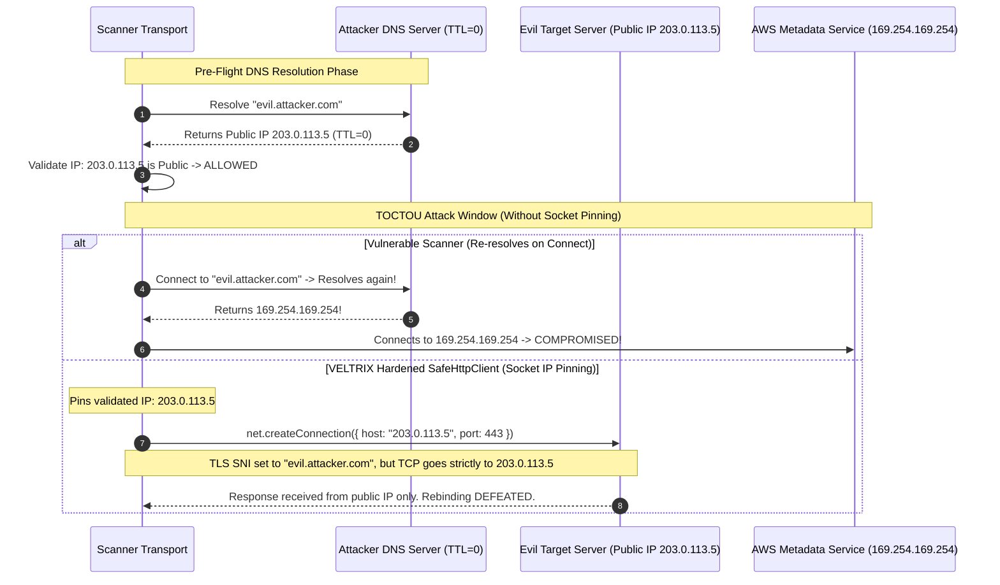

# VELTRIX: Phase 8 Threat Model Specification — Authorized Website Vulnerability Assessment

**Document Version:** 1.0.0  
**Phase:** Phase 8 (Architecture & Planning)  
**Classification:** Threat Modeling & Attack Surface Analysis  
**Methodology:** STRIDE / OWASP Top 10 / Cloud Security Alliance  
**Status:** DRAFT / IN REVIEW  
**Authors:** VELTRIX Core Security Team  

---

## 1. Threat Modeling Scope & Trust Boundaries

The Phase 8 Vulnerability Assessment Engine operates at the intersection of internal VELTRIX infrastructure and external, potentially hostile, third-party web servers. Understanding trust boundaries is essential for preventing the scanner itself from becoming an attack vector against the customer or internal cloud systems.



---

## 2. STRIDE Threat Analysis

### 2.1 Spoofing
| Threat ID | Threat Description | Attack Vector | Impact | Mitigation Strategy |
| :--- | :--- | :--- | :--- | :--- |
| **TH-SPOOF-01** | **Domain Ownership Forgery** | Attacker registers target domain owned by a third party and attempts to verify it using race conditions or forged DNS TXT queries. | Unauthorized scanning of third-party infrastructure. | Unique cryptographically random tokens (`vltx_tok_<32Hex>`), authoritative DNS lookup bypassing local recursive resolver caches, multi-step verification. |
| **TH-SPOOF-02** | **Cross-Tenant Domain Hijacking** | Tenant B attempts to verify a domain already registered and verified by Tenant A. | Unauthorized visibility into target vulnerability posture. | Strict domain uniqueness constraint in database; `GSI2_PK: DOMAIN#{primaryDomain}` conditional write rejects registration if domain is already claimed by an active organization. |
| **TH-SPOOF-03** | **Identity / Role Spoofing** | User with read-only access attempts to dispatch or abort scans. | Unauthorized scan activity or disruption. | Enforce strict JWT signature validation and role checks (`SECURITY_ADMIN` required for registration and deep scans; `SECURITY_ANALYST` for standard scans). |

### 2.2 Tampering
| Threat ID | Threat Description | Attack Vector | Impact | Mitigation Strategy |
| :--- | :--- | :--- | :--- | :--- |
| **TH-TAMP-01** | **Scan Scope Tampering** | Attacker modifies `targetUrl` or `allowedHosts` while scan is running to pivot to unauthorized networks. | Out-of-scope scanning, illegal network probing. | Immutable scan job record; `ScopeGuard` re-validates every individual outbound request against the frozen scan scope snapshot stored in the database. |
| **TH-TAMP-02** | **Vulnerability Evidence Alteration** | Malicious insider alters stored request/response evidence to frame an application or hide a critical finding. | Compromised auditability, false reports. | Cryptographic evidence signing via Phase 7 `InternalEvidenceAuthority`; any modification invalidates the HMAC-SHA256 signature and triggers security alerts. |
| **TH-TAMP-03** | **Payload Infiltration** | User submits destructive SQL/shell commands within scan profile parameters. | Unintended destructive actions against target. | Scan profiles only permit select, predefined enumerations; free-form payload injection is architecturally prohibited in the engine. |

### 2.3 Repudiation
| Threat ID | Threat Description | Attack Vector | Impact | Mitigation Strategy |
| :--- | :--- | :--- | :--- | :--- |
| **TH-REP-01** | **Scan Activity Deniability** | Tenant administrator denies ordering a scan that caused target disruption. | Legal and compliance liability. | Every scan launch, cancel, and configuration change generates an immutable, non-repudiable audit event in `AuditLog` binding user ID, org ID, IP, and timestamp. |
| **TH-REP-02** | **Finding Non-Repudiation** | Target owner claims a reported vulnerability was fabricated by VELTRIX. | Reputational damage, dispute. | Finding includes raw request/response headers, timestamped evidence hash, reproduction curl snippet, and verifiable cryptographic signature. |

### 2.4 Information Disclosure
| Threat ID | Threat Description | Attack Vector | Impact | Mitigation Strategy |
| :--- | :--- | :--- | :--- | :--- |
| **TH-INFO-01** | **SSRF to AWS Cloud Metadata Service (IMDS)** | Attacker configures scan target or HTTP redirect pointing to `http://169.254.169.254/latest/meta-data/`. | Extraction of IAM role temporary credentials and AWS account takeover. | Absolute denylisting of link-local `169.254.0.0/16`, `[fd00:ec2::254]`, and IMDS hostnames. Socket-level IP pinning prevents DNS rebinding to metadata IP. |
| **TH-INFO-02** | **SSRF to Internal Microservices & VPC** | Target redirects or resolves to internal VPC IP ranges (`10.0.0.0/8`, `172.16.0.0/12`, `192.168.0.0/16`). | Reconnaissance of internal databases, Redis caches, and private microservices. | Pre-flight DNS validation rejects RFC 1918 addresses; `net.createConnection` pins outbound sockets to public IPs only. |
| **TH-INFO-03** | **Customer Secret Leakage in Evidence** | Scanner captures HTTP request/response containing customer API keys, passwords, or bearer tokens. | Exposure of sensitive production credentials to SOC analysts. | Automated secret scrubber executes prior to evidence storage, stripping Authorization headers, session cookies, and regex-matched credential patterns. |
| **TH-INFO-04** | **Cross-Tenant Findings Leakage** | Tenant A queries API with `findingId` belonging to Tenant B. | Data breach of competitor vulnerability data. | DynamoDB queries strictly require `orgId` as partition key component (`ORG#{orgId}#SITE#{siteId}`); API gateway verifies JWT `orgId` matches requested resource. |

### 2.5 Denial of Service (DoS)
| Threat ID | Threat Description | Attack Vector | Impact | Mitigation Strategy |
| :--- | :--- | :--- | :--- | :--- |
| **TH-DOS-01** | **Target Server Saturation (Scanner-to-Target DoS)** | Scanner sends hundreds of requests per second, overwhelming target database or CPU. | Target service downtime, client outage. | Token-bucket rate limiter enforces strict RPS ceiling (default 5, maximum 20). Dynamic backoff on HTTP 429/503. Max 1 active scan per site. |
| **TH-DOS-02** | **Decompression / Zip Bomb (Target-to-Scanner DoS)** | Target serves a 10 KB gzip-compressed file that expands to 50 GB in memory. | Scanner worker out-of-memory crash, worker pool starvation. | Response decompression streams are strictly bounded with a maximum uncompressed byte limit of 10 MB. Exceeding limit terminates the stream immediately. |
| **TH-DOS-03** | **Slowloris / Infinite Stream Attack** | Target server sends HTTP headers or body at 1 byte per second indefinitely. | Exhaustion of worker sockets and thread pool. | Hard connect timeout (5s), response header timeout (10s), and body idle timeout (15s). Total request duration capped at 30s. |
| **TH-DOS-04** | **Crawl Traps & Infinite Recursive Links** | Target web application generates infinite dynamic calendar or directory links (e.g., `/calendar/2026/11/02/next...`). | Scanner stuck in infinite crawl loop, consuming quota. | Strict recursion depth limit (max 3-5), absolute URL count ceiling (max 250-1000), canonical URL path pattern repetition detection. |

### 2.6 Elevation of Privilege
| Threat ID | Threat Description | Attack Vector | Impact | Mitigation Strategy |
| :--- | :--- | :--- | :--- | :--- |
| **TH-EOP-01** | **Scanner Parser Exploitation (RCE)** | Target serves crafted HTML/XML/JSON payload designed to exploit memory safety or prototype pollution bugs in the scanner's runtime. | Remote Code Execution inside scanner worker sandbox. | Scanner runs in unprivileged container/worker sandbox with dropped capabilities, read-only root filesystem, and isolated network namespace. All parsers use hardened, well-tested zero-eval libraries. |
| **TH-EOP-02** | **Privilege Escalation via Profile Override** | Analyst user submits request with internal flags enabling unauthorized active or deep scans. | Execution of unapproved aggressive probes. | Server-side profile validation; role checks verify caller role against requested scan profile before queueing. |

---

## 3. Deep-Dive Attack Scenarios & Mitigations

### 3.1 DNS Rebinding Attack Scenario


### 3.2 Multi-Hop Redirect Escape Scenario
An attacker might serve a valid public webpage that issues an HTTP 302 redirect to an internal IP address:
```
GET https://verified-site.com/redirect?to=http://169.254.169.254/latest/meta-data/
```
**VELTRIX Defense Mechanism:**
1. Automated redirects are disabled in standard libraries (`maxRedirects: 0`).
2. When a `3xx` response is received, `SafeHttpClient` intercepts the `Location` header.
3. The redirect target is validated through `ScopeGuard`:
   - Must match `http:` or `https:`.
   - Host must match verified domains (or explicitly authorized redirect policy).
   - Pre-flight DNS resolution validates destination IP against the complete SSRF denylist.
4. If the destination resolves to `169.254.169.254` or any private range, the redirect is immediately aborted, the connection terminated, and a security alert is recorded.

---

## 4. Residual Risks & Operational Dependencies

1. **Shared Hosting / IP Co-location:** Multiple domains may share a single public IP address behind a reverse proxy (e.g., Cloudflare, Akamai). The scanner validates domain ownership via DNS/HTTP challenges, but cannot guarantee that the underlying physical server is solely dedicated to the tenant.
2. **Third-Party CDN Caching:** If the target is behind a CDN, passive checks may reflect CDN edge configurations (e.g., CDN TLS version or CDN headers) rather than the origin server.
3. **Target Intrusion Detection / WAF Blocking:** Target WAFs (e.g., Cloudflare Under Attack mode, AWS WAF rate-limiting) may block scanner IP addresses, resulting in incomplete crawls. Customers must be instructed to allowlist VELTRIX scanner egress IP ranges.
